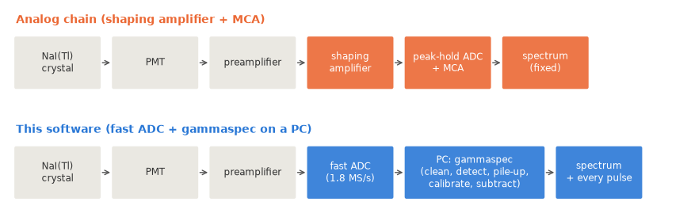
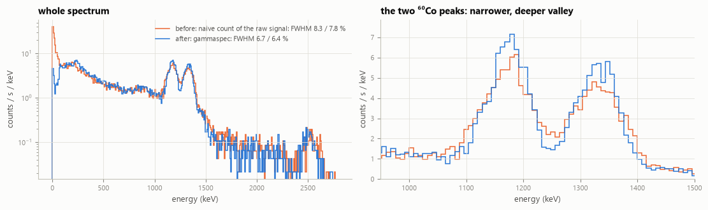

# gammaspec

**Gamma-ray spectroscopy in software.** gammaspec turns the digitised signal of a
scintillation detector into a calibrated, background-subtracted energy spectrum. It does in
software, on an ordinary PC, the work that is classically done by a **shaping amplifier and
a multichannel analyser (MCA)**: analog instruments that sit between the detector's
preamplifier and the spectrum.



It was developed and validated with 3 hours of 2021 data from a **NaI(Tl)** detector
(PMT → preamplifier → ADC at 1.8 MS/s → PC) measuring a **⁶⁰Co** source, plus a room-background
run. It also has a built-in signal simulator, so it can be tested beyond that data.

> **Status: v0.3.**
> * **Processing:** the complete chain from raw ADC files to a net spectrum, run on the full
>   dataset (6.4 M pulses; 35 GB of text become a 470 MB event list).
> * **Validation:** benchmarked against a naive peak count and an emulated analog chain, and
>   checked against simulations with known truth.
> * **Ways to run it:** a browser app, run files, live streams.
>
> See [Roadmap](#roadmap).

---

## What it replaces, and why

### The analog way

In a classic NaI(Tl) spectrometer, the preamplifier's output goes to two more instruments:

1. **Shaping amplifier.** It filters each pulse into a smooth, slower bump, which reduces
   noise. A pole-zero adjustment removes the undershoot after each pulse, a baseline
   restorer keeps the zero level steady, and a pile-up rejector discards pulses that overlap.
2. **Multichannel analyser (MCA).** For each bump, a peak-hold circuit and an ADC measure its
   height, once. The MCA adds one count to the matching channel and keeps a live-time clock
   for the time it was busy.

The output is a histogram. The pulses themselves are gone: to try other settings, you
have to measure again.

### The digital way (this software)

The preamplifier output is digitised directly by a fast ADC, and gammaspec does the rest:

| Analog function | In gammaspec |
|---|---|
| Shaping filter (noise reduction) | **Optimal filter**, designed for the measured pulse shape and noise ([detection](docs/detection.md)) |
| Pole-zero adjustment | **Pole-zero correction** computed from the measured pulse model ([baseline](docs/baseline-restoration.md)) |
| Baseline restorer | **Baseline tracker**, plus removal of interference lines |
| Pile-up rejector (discards both pulses) | **Pile-up solver**: overlapping pulses are separated and *each one is measured* ([pile-up](docs/pileup-solver.md)) |
| Peak-hold ADC (one sample of the bump) | **Template fit** over the whole pulse, with sub-sample timing |
| MCA histogram + live-time clock | **Event list**: every pulse with its time, amplitude and quality flags, then histograms in any binning; exact live time |
| Manual energy calibration | **Automatic calibration** from known lines; gain matching between runs ([spectrum](docs/spectrum.md)) |

### Why do it in software

* **Lower cost.** The shaping amplifier, pile-up rejector, MCA (and often the instrument
  crate that powers them) are separate, specialised instruments. Here they are replaced by
  one ADC board and a PC, and improvements come as software updates, not new hardware.
* **More portable.** Detector, preamplifier, ADC board and a laptop are the whole
  spectrometer, which makes field and in-plant measurements practical.
* **Better at high count rates.** Overlapping pulses are measured instead of thrown away, and
  the threshold is lower. On the same recorded pulses, gammaspec beats an emulated analog
  chain on resolution, peak separation and threshold, and loses no pulses to pile-up
  rejection (below).
* **Nothing is thrown away.** Every pulse is kept with its time stamp. A measurement can be
  re-processed later with other settings or better algorithms, without measuring again.
* **Transparent.** Every step is documented, tested, and checked against simulations whose
  true content is known.

### Results at a glance



*20 recorded captures: a naive count of the raw signal (before) and gammaspec (after), each
calibrated to keV.*

The same 100 recorded captures of the ⁶⁰Co run, processed three ways and calibrated the same
way ([details](docs/benchmark.md)):

| | Naive peak count (`find_peaks`) | Analog chain (emulated: CR-RC⁴ 0.5 µs + pile-up rejection) | **gammaspec** |
|---|---|---|---|
| Resolution (FWHM) at 1173 / 1332 keV | 8.27 / 7.44 % | 6.95 / 6.21 % | **6.54 / 6.05 %** |
| Valley between the ⁶⁰Co peaks (lower = better separated) | 0.39 | 0.24 | **0.215** |
| Lowest energy recorded | none (noise is counted) | ≈ 44 keV | **≈ 6 keV** |
| Overlapping pulses | merged or split | rejected | **separated and measured** |

On simulated data with known content:
* the program finds ≥ 99.3 % of pulses above 100 keV;
* it separates 99.6 % of pulse pairs that are 1–33 µs apart;
* it adds no measurable broadening to the peaks ([simulation](docs/simulation.md)).

Typical 3″×3″ NaI(Tl) detectors with analog electronics reach ≈ 7 % at 662 keV and ≈ 5 % at
1332 keV. At those energies, resolution is set mostly by the crystal and PMT, so those
values come from other detectors and are context, not a like-for-like comparison.

### Background

The author first worked on this approach for **Serva Energy's** digital data-acquisition
system, helping build its foundation while it sampled at 1.8 MS/s; it moved to 3.4 MS/s as
that work ended. A year later, the company presented a modular system recording up to
250 MS/s at 16 bits, with its own real-time analysis, at the 11th ICI conference (Saskatoon,
July 2023). There it reported a slightly better 662 keV resolution and lower dead time than
a commercial digital MCA (Canberra DSA-1000).

**This repository is an independent, from-scratch implementation.** The original code is
not available, and this project is not affiliated with or endorsed by Serva Energy. It
rebuilds the method openly, with full documentation, tests and validation.

---

## What it does, step by step

```text
raw ADC capture files
  → 1. lossless binary store        (7 MB of text per 0.29 s capture → 0.7 MB)
  → 2. characterisation             (pulse template, pulse model, noise)
  → 3. interference removal, pole-zero correction, baseline tracking
  → 4. pulse detection              (optimal filter, successive cancellation)
  → 5–6. pile-up resolution         (weighted least squares, sub-sample timing)
  → 7. calibration, spectra, background subtraction
```

Every stage can be switched on or off and configured, from the app or a run file. Input can
be raw files, prepared stores, a live stream (a file or FIFO a digitiser writes to, or a
recording replayed at real time), or the built-in simulator. **To see each step with
before/after pictures, start with
[Part 0 of the walkthrough](docs/walkthrough.ipynb)**.

## Installation

Requires Python ≥ 3.11.

```bash
git clone https://github.com/AyubSherif/GammaSpectroscopySoftwareAddOns.git
cd GammaSpectroscopySoftwareAddOns
python -m venv .venv
# Windows: .venv\Scripts\activate    Linux/macOS: source .venv/bin/activate
pip install -e ".[app]"         # the program and the browser app
pip install -e ".[app,dev]"     # plus tests and the walkthrough notebook
```

## Quick start

**The app** (choose the input, switch stages on and off, run, watch the live spectrum):

```bash
gammaspec app                   # opens http://localhost:8501
```

**Without data:** a simulated ⁶⁰Co measurement, processed and checked against the truth:

```bash
gammaspec run examples/run_simulation.toml
gammaspec stream sim out/sim --duration 20 --show        # live spectrum window
```

**With recorded data**, from a run file:

```bash
gammaspec config init my_run.toml      # every setting, at its default, commented
# edit: [input] kind = "raw", source = "ADC_raw_output", background = "ADC_raw_output_background"
gammaspec run my_run.toml              # convert → template → events → spectrum (→ benchmark)
```

**As a live stream:**

```bash
gammaspec stream data/source_first100.h5 out/replay --template T.h5 --realtime --show   # replay at real time
my_digitiser | gammaspec stream - out/live --template T.h5                              # samples on stdin
```

**Step by step** ([CLI reference](docs/cli.md)): `index`, `convert`, `characterize`,
`process`, `spectrum`, `benchmark`, `simulate`, …; or from Python:

```python
from gammaspec.store import CaptureStore

with CaptureStore("data/source_first100.h5") as store:
    volts = store.volts(0)          # the first capture, in volts
```

## Documentation

In reading order, each document with the code it describes:

| # | Document | Contents | Code |
|---|---|---|---|
| 1 | [docs/walkthrough.ipynb](docs/walkthrough.ipynb) | **Part 0:** the app in pictures, before and after every step. **Parts A–K:** every function in call order, on real data, with the maths | all; built by [docs/build_walkthrough.py](docs/build_walkthrough.py) |
| 2 | [docs/architecture.md](docs/architecture.md) | Pipeline design, module map, how the stages fit together | all (module map) |
| 3 | [docs/data-formats.md](docs/data-formats.md) | Step 1: raw capture format, HDF5 store, event file, truth and live-spectrum files | [rawio.py](gammaspec/rawio.py), [store.py](gammaspec/store.py), [events.py](gammaspec/events.py) |
| 4 | [docs/characterization.md](docs/characterization.md) | Step 2: measured pulse shape, pulse template, noise and preliminary spectra | [signal.py](gammaspec/signal.py), [template.py](gammaspec/template.py), [noise.py](gammaspec/noise.py), [characterize.py](gammaspec/characterize.py), [spectrum.py](gammaspec/spectrum.py), [plotting.py](gammaspec/plotting.py) |
| 5 | [docs/baseline-restoration.md](docs/baseline-restoration.md) | Step 3: interference removal, pole-zero correction, baseline tracker | [interference.py](gammaspec/interference.py), [baseline.py](gammaspec/baseline.py), [preprocess.py](gammaspec/preprocess.py), [restoration.py](gammaspec/restoration.py) |
| 6 | [docs/detection.md](docs/detection.md) | Step 4: pulse detection and the event list | [detect.py](gammaspec/detect.py), [events.py](gammaspec/events.py), [pipeline.py](gammaspec/pipeline.py), [detection_eval.py](gammaspec/detection_eval.py) |
| 7 | [docs/pileup-benchmark.md](docs/pileup-benchmark.md) | Step 5: pile-up methods (TM, HYPER, LS/GLS/WLS) compared | [pileup.py](gammaspec/pileup.py), [pileup_eval.py](gammaspec/pileup_eval.py) |
| 8 | [docs/pileup-solver.md](docs/pileup-solver.md) | Step 6: the pile-up solver in the pipeline | [solver.py](gammaspec/solver.py), [pipeline.py](gammaspec/pipeline.py) |
| 9 | [docs/spectrum.md](docs/spectrum.md) | Step 7: calibration, gain matching, background subtraction; full 3-hour results | [calibration.py](gammaspec/calibration.py), [analysis.py](gammaspec/analysis.py), [spectrum.py](gammaspec/spectrum.py) |
| 10 | [docs/benchmark.md](docs/benchmark.md) | Step 8: gammaspec vs a naive count vs an emulated analog chain vs typical analog systems | [benchmark.py](gammaspec/benchmark.py) |
| 11 | [docs/configuration.md](docs/configuration.md) | Step 9: the run file: input, stage switches, every parameter | [config.py](gammaspec/config.py), [runner.py](gammaspec/runner.py), [examples/](examples/) |
| 12 | [docs/simulation.md](docs/simulation.md) | Step 10: the signal simulator, and the pipeline scored against the truth | [simulate.py](gammaspec/simulate.py) |
| 13 | [docs/streaming.md](docs/streaming.md) | Step 10: live input, overlapping frames, live spectrum, speed | [sources.py](gammaspec/sources.py), [stream.py](gammaspec/stream.py), [liveplot.py](gammaspec/liveplot.py) |
| 14 | [docs/app.md](docs/app.md) | Step 11: the browser app | [app.py](gammaspec/app.py) |
| 15 | [docs/cli.md](docs/cli.md) | Command-line reference | [cli.py](gammaspec/cli.py) |
| 16 | [docs/development.md](docs/development.md) | Environment, tests, conventions | [tests/](tests/), [pyproject.toml](pyproject.toml) |
| 17 | [docs/adr/](docs/adr/) | Architecture Decision Records: why things are the way they are (0001–0013) | — |
| 18 | [CHANGELOG.md](CHANGELOG.md) | Release history | — |

## Roadmap

1. ✅ Ingestion: fast reader, lossless binary store, chronological index
2. ✅ Pulse template and noise characterisation ([results](docs/characterization.md))
3. ✅ Interference removal and baseline restoration ([results](docs/baseline-restoration.md))
4. ✅ Pulse detection and the event list ([results](docs/detection.md))
5. ✅ Pile-up methods compared: template matching vs HYPER vs least squares ([results](docs/pileup-benchmark.md))
6. ✅ Pile-up solver in the pipeline ([results](docs/pileup-solver.md))
7. ✅ Calibration, gain matching, background subtraction; full 3-hour run ([results](docs/spectrum.md))
8. ✅ Benchmark against a naive count and an emulated analog chain ([results](docs/benchmark.md))
9. ✅ Every stage selectable from a run file ([docs](docs/configuration.md))
10. ✅ Streaming, live spectrum, signal simulator with truth ([streaming](docs/streaming.md), [simulation](docs/simulation.md))
11. ✅ Browser app and packaging ([docs](docs/app.md))

Possible next steps:
* a faster pile-up solver, for real-time 1.8 MS/s on 4–6-core PCs;
* a Compton-edge continuum model for unbiased FWHM;
* re-characterisation at higher sampling rates;
* isotope identification against nuclide libraries.
