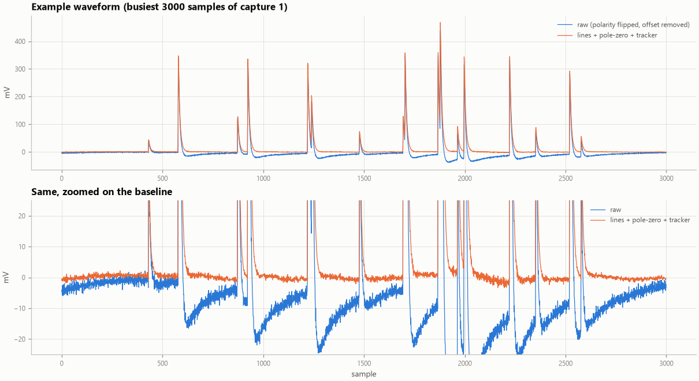
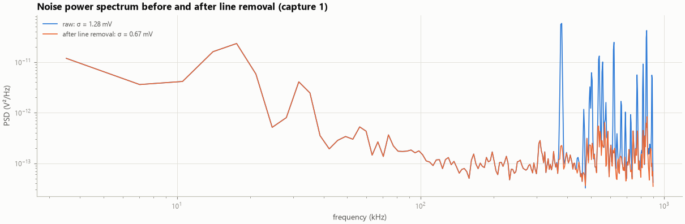
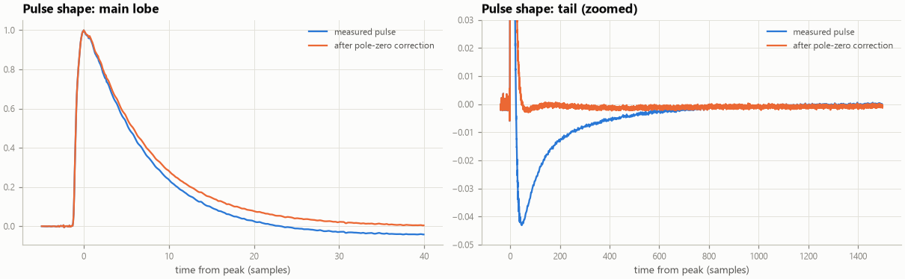
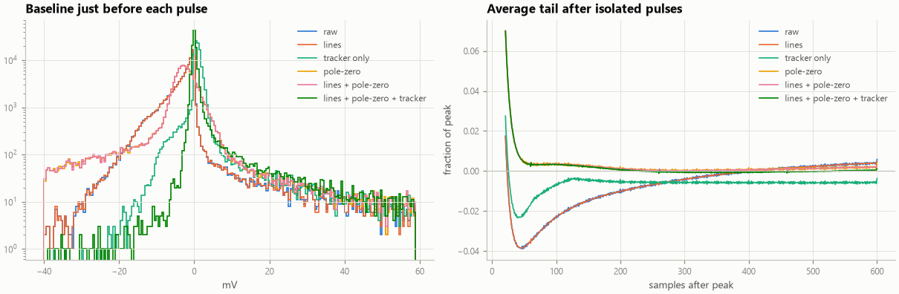

# Waveform pre-processing: interference removal and baseline restoration

This stage turns the raw ADC signal into a clean one: every pulse sits on a flat
zero baseline, and the narrow-band interference is removed. It has three stages,
each optional ([ADR-0003](adr/0003-modular-optional-stages.md)):

```text
raw volts ─► polarity + offset ─► [line removal] ─► [pole-zero] ─► [baseline tracker] ─► clean signal
```

Code: `gammaspec/interference.py`, `gammaspec/baseline.py`, `gammaspec/preprocess.py`.
Evaluation: `gammaspec evaluate-restoration` (`gammaspec/restoration.py`).

## Why it is needed

Each pulse is followed by an undershoot (−4.3 % of the peak, recovering over about
500 µs) caused by AC coupling in the electronics. At 4,300 pulses/s about **44 % of
pulses arrive 60–300 samples after an earlier pulse**, i.e. on its undershoot. If you
measure them against a fixed zero (as thresholding does), they read low and the
peaks broaden:



## The stages

### 0. Polarity and offset (always on)
The signal is flipped so pulses are positive. The capture mean is subtracted: because
the coupled pulses have zero net area, the mean of the signal is exactly the electronic
offset, even at high count rates. A median would be biased by the undershoots.

### 1. Line removal (`line_removal`)
The interference is a set of narrow lines: a family at multiples of 9 kHz (= fs/200,
probably from the acquisition board) plus an intermittent line near 257 kHz.

1. Pulses (20 samples before to 60 after each trigger) are masked out.
2. **Detection:** the full-capture spectrum of the masked signal is searched for
   peaks more than 100× above the local median. Each line must be the strongest peak
   within ±3.5 kHz, and closer lines are merged. Up to 40 lines are kept.
3. **Subtraction:** in 1024-sample blocks with 50 % overlap, the cos/sin amplitude of
   every line is fitted **using only pulse-free samples**. The block-wise fit lets
   amplitude and phase drift. The overlap-added model is subtracted from every sample:
   inside a pulse the interference is interpolated from its surroundings, so pulses
   are not distorted (unlike notch filters, which ring after every pulse).

It takes about 0.09 s per capture (6 M samples/s). Details:
[ADR-0006](adr/0006-interference-line-removal.md).



### 2. Pole-zero correction (`pole_zero`)
Undoes the AC coupling with a short IIR filter derived from the fitted pulse model
(see [characterization.md](characterization.md)):

* The coupling shows up as slow **poles** in the pulse's z-transform (the undershoot
  exponentials, τ = 76 and 318 samples) and as **zeros** near z = 1 (which give the
  zero net area).
* The filter puts **zeros on the undershoot poles** and **poles on those near-DC
  zeros** (τ = 111 samples, and one at DC clamped to a 20,000-sample leak for
  stability).
* Result: the undershoot disappears, the main lobe keeps its shape (slightly longer),
  and the tail is flat to about 0.1–0.3 % of the peak.



The filter boosts very low frequencies (×2 at 900 Hz, ×13 at 90 Hz), so slow drifts
grow. **Pole-zero must be followed by the baseline tracker**; on its own it is worse
than no processing. The code warns if you enable it without the tracker. Details:
[ADR-0005](adr/0005-pole-zero-from-pulse-model.md).

### 3. Baseline tracker (`baseline_tracker`)
A centred moving average (1001 samples ≈ 0.56 ms) of the pulse-free samples (main
lobes masked from 10 samples before to 50 after each pulse), interpolated across gaps
and subtracted. It removes what is left: slow drift, the filter's low-frequency boost,
and residual offsets. Without pole-zero it can follow the undershoot only partly
(use a short window, about 151 samples).

### Capture start
The first 1500 samples of each capture are not fully corrected, because tails of pulses
from before the capture started are unknown. Events there should be flagged by later
stages (`PreprocessConfig.warmup_samples`).

## Results (first 100 captures of each run, 29.1 s live time each)

Every configuration measures the **same pulses** (selected on the raw signal, main
lobe clean, outside the warm-up region). Amplitudes come from the template fit, either
with a free baseline per pulse (`b free`) or with the baseline fixed at zero (`b = 0`).

### ⁶⁰Co run (≈ 98,000 pulses)

| Configuration | Noise σ (mV) | Baseline before pulse: robust σ (mV) | Pulses > 5 mV off | Tail at +60 samples | FWHM 1173 / 1332 keV, b free | FWHM, b = 0 |
|---|---|---|---|---|---|---|
| raw | 1.69 | 2.14 | 21.9 % | −3.5 % | 6.58 / 5.91 % | 7.81 / 6.57 % |
| lines | 0.49 | 2.15 | 21.9 % | −3.6 % | 6.58 / 5.92 % | 7.81 / 6.56 % |
| tracker only | 1.69 | 0.77 | 1.7 % | −1.7 % | 6.58 / 5.96 % | 6.65 / 5.99 % |
| pole-zero | 1.68 | 2.68 | 21.6 % | +0.3 % | 6.60 / 5.89 % | 7.68 / 6.75 % |
| lines + pole-zero | 0.49 | 2.68 | 21.6 % | +0.3 % | 6.59 / 5.89 % | 7.70 / 6.74 % |
| **lines + pole-zero + tracker** | **0.49** | **0.45** | **0.4 %** | **+0.2 %** | 6.59 / 5.89 % | **6.50 / 5.93 %** |

**Pulses on the tail of an earlier pulse** (60–300 samples after it; 43,456 pulses)
compared with clean pulses (more than 300 samples after):

| Configuration, fit | Peak position, on tail vs clean | FWHM on tail (clean) |
|---|---|---|
| raw, b = 0 (like thresholding) | **−1.6 %** (0.3076 vs 0.3132 V) | **7.94 / 6.82 %** (6.62 / 5.97 %) |
| raw, b free | −0.3 % | 6.64 / 5.98 % (6.57 / 5.82 %) |
| **lines + pole-zero + tracker, b = 0** | **0.0 %** (0.3158 vs 0.3157 V) | **6.50 / 5.93 %** (6.47 / 5.83 %) |



### Background run (⁴⁰K, ≈ 28,000 pulses)

| Configuration | Noise σ (mV) | Baseline robust σ (mV) | FWHM ⁴⁰K, b free | FWHM, b = 0 |
|---|---|---|---|---|
| raw | 6.31 | 1.30 | 6.64 % | 6.93 % |
| lines | 3.99 | 1.13 | 6.61 % | 6.65 % |
| lines + pole-zero + tracker | 3.97 | 1.08 | 6.78 % | 6.60 % |

In the noisy background captures, line removal leaves broadband noise (σ ≈ 4 mV) that
can't be filtered without harming pulses. ⁴⁰K has few counts, so these FWHM values are
uncertain by about ±0.3 %.

## Conclusions

1. **The recommended chain is lines + pole-zero + tracker, then fitting with the
   baseline fixed at 0.** Pulses on an earlier pulse's tail are then measured exactly
   like isolated pulses: no shift, no broadening. One fewer fit parameter per pulse.
2. **Line removal** brings the noise to the white floor (1.7 → 0.5 mV in the source
   run). At ⁶⁰Co energies the resolution is set by the NaI crystal (≈ 6 %), so the gain
   shows at low energies (threshold, small pulses) and in fewer false triggers.
3. **Pole-zero without the tracker is harmful**, and the tracker alone only partly
   restores the baseline. They belong together.
4. With a free per-pulse baseline the raw data already does well for *isolated* main
   lobes. The flat baseline matters most where a per-pulse baseline can't help:
   overlapping pulses (pile-up, steps 5–6), detection thresholds (step 4), and
   reducing the data to events.
