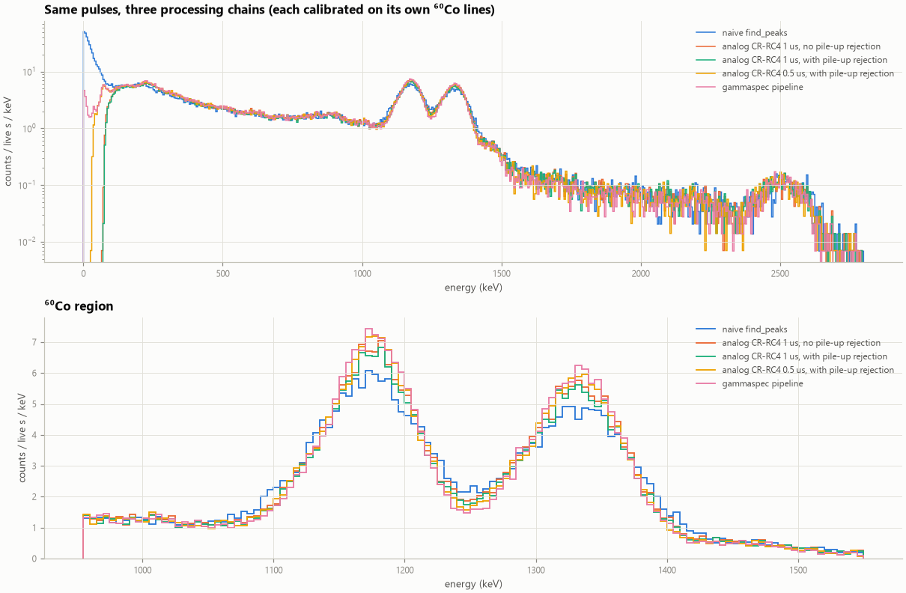

# Benchmark: naive peak count vs analog chain vs gammaspec

This benchmark asks how much the processing in `gammaspec` improves the spectrum. It
compares three ways of turning the same recorded PMT waveforms into a spectrum:

1. **Naive:** `scipy.signal.find_peaks` on the raw waveform, with no transformation.
2. **Analog:** an emulated conventional NaI(Tl) chain (preamplifier + shaping amplifier + MCA).
3. **gammaspec:** the full pipeline.

The results are also put next to typical published values for NaI(Tl) detectors read out
with analog electronics.

Code: `gammaspec/benchmark.py`. Decision record:
[ADR-0010](adr/0010-benchmark-on-same-data.md).

```bash
gammaspec benchmark data/source_first100.h5 data/events/source_first100.h5 data/benchmark/first100
#   --first N0 --n N   choose the captures (default: the first 100; --n 0 = all)
```

Outputs: `benchmark_summary.json` (all metrics of all chains) and `benchmark_spectra.png`.

## The chains

All chains read the **same captures** (the first 100 of the source run, 29 s). Each chain is
calibrated by **the same automatic procedure** (`calibration.calibrate`, on its own ⁶⁰Co
lines; see [spectrum.md](spectrum.md)). So every difference in the table below comes from the
processing.

| Chain | What it does |
|---|---|
| **naive `find_peaks`** | Flip the polarity and subtract the capture median; nothing else. Each local maximum above 5 × the noise σ, at least 5 samples from the next, counts as a pulse, and its height is the peak sample. No baseline correction, no pile-up handling, no dead time. |
| **analog CR-RC⁴, 1 µs, no PUR** | Emulates the textbook chain on the digitised waveform. A **shaping amplifier** (pole-zero-cancelled CR differentiator, which removes the 4.1 µs pulse decay, followed by four RC integrators; semi-Gaussian output) and a **baseline restorer**. Then a **peak-sensing ADC**, i.e. a peak-hold with parabolic interpolation. A **lower-level discriminator** at 5 σ of the shaped noise. **5 µs non-extending ADC dead time** after each conversion, with an MCA **live-time clock**. |
| **analog CR-RC⁴, 1 µs, with PUR** | As above, plus a **pile-up rejector**: both pulses are discarded when two triggers fall within one shaped-pulse width (10 τ). The rejected time is subtracted from live time. |
| **analog CR-RC⁴, 0.5 µs, with PUR** | The same with 0.5 µs shaping: shorter pulses, so less pile-up. |
| **gammaspec** | The pipeline's event file: interference removal, pole-zero correction and baseline tracking, optimal-filter detection, and the pile-up solver. Good events only (isolated + resolved pile-up). |

The "preamplifier" is the PMT anode load already present in the recording. The pulse leaves
the anode with a 4.1 µs decay, like a voltage-mode preamp output, and the shaper's pole-zero
stage is set to that decay. 0.5–1 µs is the usual shaping range for NaI(Tl), whose light
decays in 0.25 µs.

## Metrics

| Metric | Definition |
|---|---|
| **FWHM, resolution** | Joint Gaussian fit of the 1173 and 1332 keV peaks on a linear background, 1040–1440 keV, 2 keV bins. Reported in keV and as % of the line energy (= resolution). |
| **Valley-to-peak** | The minimum of the spectrum between the two ⁶⁰Co peaks divided by the mean of the two peak maxima (5 keV bins). Lower means better-separated peaks: it combines resolution and pile-up/continuum. |
| **Peak rates** | Full-energy-peak counts per live second (`analysis.fit_line_groups`). This tests dead-time and pile-up losses: a correct chain should give the same rate. |
| **Pile-up continuum** | Counts per live second at 1450–2450 keV. This is between the ⁶⁰Co peaks and their sum peak, where most counts are chance coincidences. |
| **Threshold** | 1st percentile of the recorded energies below 300 keV: the lowest energy the chain records. |
| **Recorded / live** | The fraction of triggers that end up in the spectrum, and the live-time fraction. |

## Results (first 100 captures, 29 s)



| | naive `find_peaks` | analog 1 µs, no PUR | analog 1 µs, PUR | analog 0.5 µs, PUR | **gammaspec** |
|---|---|---|---|---|---|
| FWHM 1173 keV | 97.0 keV (8.27 %) | 84.3 keV (7.18 %) | 83.5 keV (7.11 %) | 81.6 keV (6.95 %) | **76.8 keV (6.54 %)** |
| FWHM 1332 keV | 99.1 keV (7.44 %) | 87.1 keV (6.55 %) | 86.5 keV (6.50 %) | 82.7 keV (6.21 %) | **80.5 keV (6.05 %)** |
| Valley-to-peak | 0.390 | 0.290 | 0.279 | 0.239 | **0.215** |
| Peak rate 1173 keV (/s) | 504 ± 9 | 508 ± 7 | 493 ± 7 | 517 ± 7 | **514 ± 6** |
| Peak rate 1332 keV (/s) | 455 ± 11 | 462 ± 8 | 447 ± 8 | 464 ± 7 | **465 ± 7** |
| Pile-up continuum (/s) | 113.2 | 109.0 | 104.6 | 95.8 | **91.5** |
| Threshold | none (noise triggers) | ≈ 84 keV | ≈ 86 keV | ≈ 44 keV | **≈ 4–6 keV** |
| Triggers → recorded | 177,291 → 177,291 | 116,361 → 116,256 | 116,361 → 112,884 | 124,056 → 121,920 | 132,993 → 128,970 |
| Live fraction | (100 %, no dead time) | 98.0 % | 98.0 % | 97.9 % | 100 % ¹ |

Statistical errors of the FWHM are 0.07–0.15 % (absolute). ¹ The only time gammaspec loses
is the 1,500-sample start-up of each capture, which is excluded from real time too. Pile-up
is resolved, not rejected, so the live time is not reduced.

### What each step buys

* **Naive → anything:** the naive count is the worst in every metric. Its 177k "pulses" include
  thousands of noise and interference maxima. It has no threshold: the 1st percentile is
  0.4 keV, i.e. noise. Every pulse sitting on the undershoot of an earlier one is measured
  low, so the peaks are 97–99 keV wide. Pile-up merges pulses or splits them into several
  maxima. This is what "no transformation" costs: **+26 % FWHM at 1173 keV and +23 % at
  1332 keV** relative to gammaspec, and almost twice the valley-to-peak ratio.
* **Shaping (analog):** filtering the noise and cancelling the decay removes most of that. A
  1 µs CR-RC⁴ already reaches 6.55 % at 1332 keV.
* **Pile-up rejection** improves the valley slightly (0.290 → 0.279). It loses 3 % of the
  pulses, and the peak rates drop by 3 % (493 vs 508 /s). The live-time correction for
  rejected pulses cannot recover this exactly, as is well known for analog PUR.
* **Shorter shaping (0.5 µs)** is better on this data, because pile-up dominates over
  electronic noise at 4,500 /s.
* **gammaspec vs the best analog setting (0.5 µs, PUR):**

  | | Best analog | gammaspec | Change |
  |---|---|---|---|
  | FWHM 1173 keV | 81.6 keV | 76.8 keV | −6 % |
  | FWHM 1332 keV | 82.7 keV | 80.5 keV | −3 % |
  | Valley-to-peak | 0.239 | 0.215 | −10 % |
  | Pile-up continuum | 95.8 /s | 91.5 /s | −4.5 % |
  | Threshold | ≈ 44 keV | ≈ 4–6 keV | about 10× lower |
  | Pulses lost | none | none | same peak rates within errors |

  gammaspec's detection threshold is 1.53 mV ≈ 6 keV (see [detection.md](detection.md)).
  The 1st-percentile metric gives 3.6 keV because of noise near the threshold. The low
  threshold comes from the optimal filter. The rest comes from fitting the template to all
  samples of the pulse (not one peak sample) and from resolving pile-up instead of rejecting
  it.

### Against typical analog NaI(Tl) systems (different detectors)

| | FWHM at 662 keV | FWHM at 1332 keV |
|---|---|---|
| Typical 3″×3″ NaI(Tl) + preamp/amp/MCA (literature) | ≈ 7 % (6.5–8 %) | ≈ 4.8–5.5 % |
| This detector, emulated analog chain (1 µs / 0.5 µs) | — (no ¹³⁷Cs line) | 6.5 % / 6.2 % |
| This detector, gammaspec (first 100 / full run, good events) | — | 6.05 % / 6.05 % |
| This detector, gammaspec, isolated pulses only (full run) | — | 6.03 % |

Sources: an NaI(Tl) teaching-lab manual (KFUPM), Berkeley Nucleonics' RIID detector notes,
the UC Davis gamma spectroscopy guide and an Edinburgh lab report. These give ~7 % at 662 keV
as the standard figure for good 3″×3″ crystals, which scales as about 1/√E to ~5 % at
1332 keV. Values for smaller crystals or older PMTs are higher.

* **This comparison is with other detectors.** The crystal size and the PMT of this setup
  are not known. NaI(Tl) resolution at 1.3 MeV is set mostly by the crystal and the PMT
  (light yield, uniformity, photo-electron statistics), not by the electronics. Our
  detector is 0.5–1 % (absolute) worse than a good 3″×3″ crystal, **with any processing**:
  the emulated analog chain sees the same limitation.
* The fair comparison is therefore the one in the table above: **the same pulses through
  the analog chain and through gammaspec.** There, gammaspec is 3–6 % narrower in FWHM, has
  10 % better peak separation and a ~10× lower threshold, and it loses no pulses to pile-up
  rejection.
* The emulated analog chain is an **optimistic** analog chain. It adds no electronic noise of
  its own (a real shaper and ADC do), it has an ideal pole-zero setting and a perfect ADC
  (no differential non-linearity), and it uses the same digitised samples.

## Caveats

* The gammaspec FWHM here (6.54 / 6.05 %) comes from the benchmark's fit (2 keV bins,
  1040–1440 keV), applied identically to every chain. `gammaspec spectrum` uses 5 keV bins
  and gives 6.56 / 6.04 % for the same events. The difference is within the errors.
* **Absolute FWHM values are model-dependent.** The fit uses two Gaussians on a linear
  background. On simulated ⁶⁰Co spectra with known widths, this underestimates the FWHM by
  8–10 %, because the 1332 keV Compton edge lies under the 1173 keV peak
  ([simulation.md](simulation.md#two-findings-that-only-a-simulation-can-show)).
  * The comparison between chains is unaffected: the same fit is used for all.
  * The comparison with literature values is affected: those values come from other fit
    methods, and the true widths here may be somewhat larger than quoted.
* Only 29 s of data are used: the analog emulation runs at about real-time speed in
  Python. The full run (6.18 M good events) gives 6.62 / 6.05 % with the benchmark's fit,
  and isolated pulses alone 6.57 / 6.03 %. This matches the first 100 captures within
  0.1 %, so the first 100 captures are representative, and resolved pile-up is as good as
  isolated pulses.
* The naive chain's settings (5σ, 5-sample distance) are reasonable defaults, not tuned.
  Different settings trade noise triggers against merged pulses, but do not fix the baseline
  problem.
