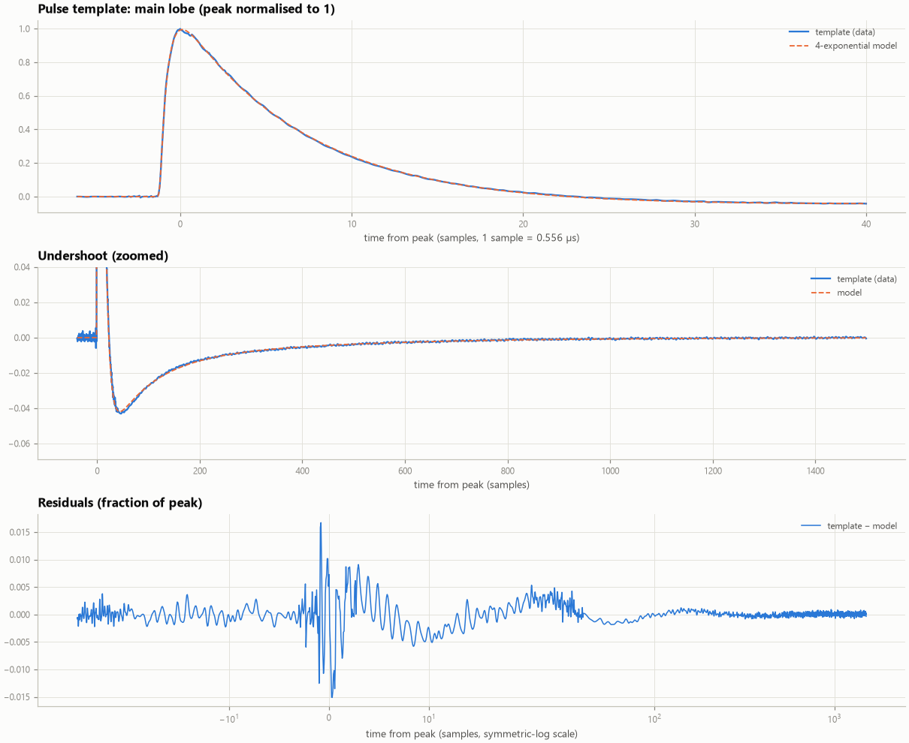
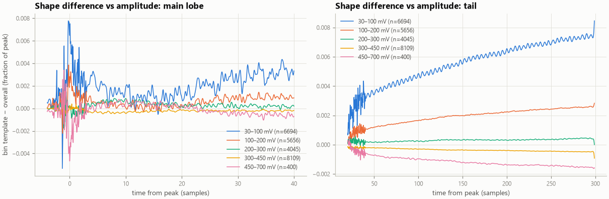
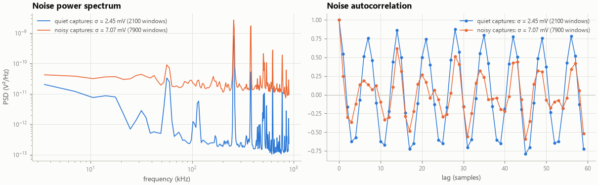
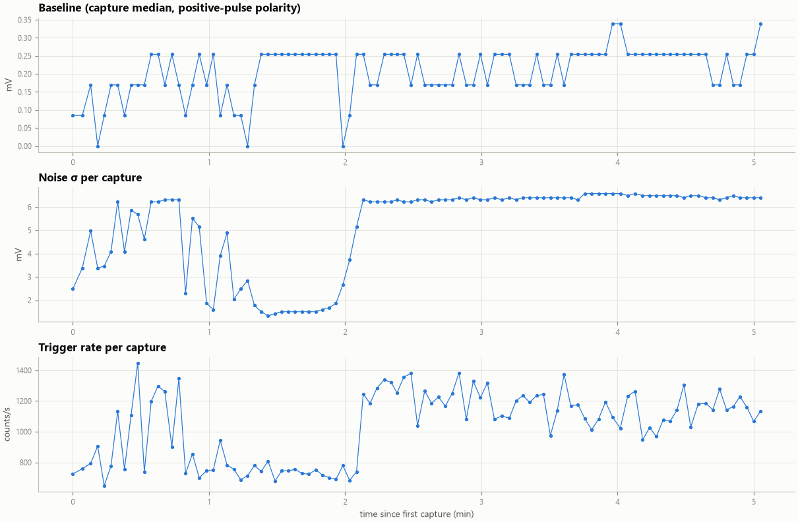
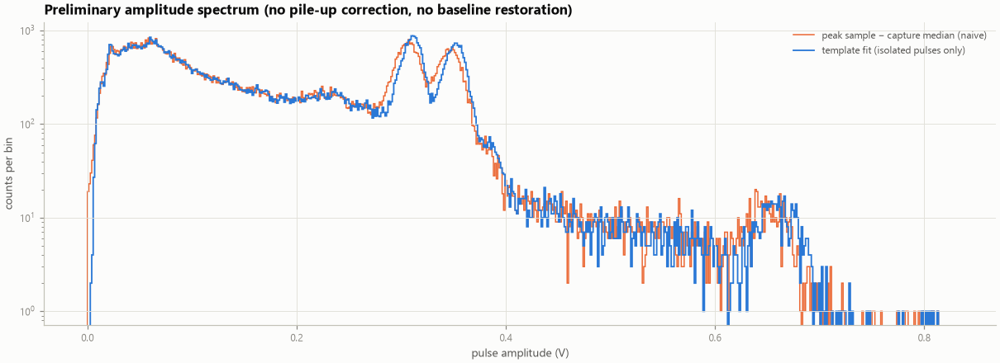

# Detector characterisation (2021 NaI(Tl) data)

Results of `gammaspec characterize` on the first 100 captures (29.1 s of live time) of
each run. The source run is ⁶⁰Co, 2021-08-26; the background run is 2021-08-31.
These numbers set the parameters of the later processing stages.

Reproduce:

```bash
gammaspec characterize data/background.h5 data/characterization/background
gammaspec characterize data/source_first100.h5 data/characterization/source \
    --template-post 300 --isolation-pre 300 --isolation-post 300 \
    --compare data/characterization/background/template.h5
```

The source run needs a shorter window. At 4,300 pulses/s, fewer than 0.2 % of
pulses are 1,500 samples away from both neighbours.

## Summary

| Quantity | Background run | Source run (⁶⁰Co) | Notes |
|---|---|---|---|
| Trigger rate (5σ) | 1,035 /s | 4,309 /s | background: 736 /s when quiet, 1,115 /s with interference (false triggers) |
| White-noise floor | ≈ 0.4 mV (quiet captures) | ≈ 0.5 mV | √(PSD × bandwidth) |
| Total noise σ | 1.6 mV quiet / 6.3 mV noisy | 1.4–1.7 mV | dominated by interference lines, not white noise |
| Clipping | none | none | most negative code −93,123 (−7.9 V); no repeated extreme values |
| Isolated pulses used for the template | 1,623 (±1,500 samples) | 24,924 (±300 samples) | |
| Pulses with a clean main lobe | 28,539 | 98,576 (≈ 79 % of triggers) | the remaining ≈ 21 % need pile-up handling |

## Pulse shape



The template is the average of isolated pulses on a grid of 1/16 sample, aligned by
each pulse's fitted sub-sample time (see [ADR-0004](adr/0004-template-construction.md)).
The analytic fit is a sum of exponentials smoothed by a Gaussian, with the pulse
starting from zero:

| Component | Background fit | Source fit | Interpretation |
|---|---|---|---|
| τ₁ (rise) | 0.245 µs | 0.246 µs | NaI(Tl) light decay (230–250 ns) |
| τ₂ (main decay) | 4.17 µs | 4.10 µs | decay time constant of the preamplifier |
| τ₃ (undershoot) | 42 µs | 69 µs | AC coupling |
| τ₄ (undershoot) | 176 µs | — | second coupling stage; the 300-sample source window is too short to separate it |
| Gaussian smoothing σ | 0.036 µs | 0.037 µs | front-end bandwidth |

* **Undershoot:** the minimum is −4.3 % of the peak, 46 samples (26 µs) after it.
  The undershoot is back to zero after about 1,000 samples.
* **Net area ≈ 0.** The positive lobe has area 7.65 (samples × peak) and the
  undershoot cancels it to within 0.5 %. That is the signature of pure capacitive
  coupling. **So the undershoot can be removed exactly by inverting the coupling
  (pole-zero correction)**, which is the basis for baseline restoration (step 3).
* **Data template vs model:** the model matches within ±1.5 % of the peak; the
  largest deviations are on the rising edge. Energy fits use the **data template**;
  the model provides physical time constants (for example for pole-zero correction).
* **Source vs background template:** the main lobe agrees within 0.5 % of the peak.

### Shape vs amplitude



Normalised templates for amplitude bins from 30 mV to 700 mV (about 100 keV to
2.7 MeV) agree with the overall template within **0.1–0.8 % of the peak** (source
run, thousands of pulses per bin). The background bins show about 2 %, but they have
only about 300 pulses each, so that is the statistical limit. **No dependence of shape
on amplitude was found in the energy range of interest**, so one template is valid
everywhere. Pulses above about 1 V (cosmic muons) are too few to test.

## Noise



* **Interference dominates the noise.** Narrow lines at **256.6 kHz (and harmonics
  at 513 and 773 kHz)**, **379.7 kHz**, 541, 622 kHz and others sit up to 300× above
  the white floor. The noise autocorrelation oscillates with a period of 7 samples.
  This looks like pickup from switching power supplies, for example the PMT high-voltage or preamplifier
  high-voltage supply or DC-DC converters.
* **The interference switches on and off.** In the background run, 79 % of captures are
  "noisy" (σ ≈ 6.3 mV) and the rest "quiet" (σ ≈ 1.6 mV); the switching is
  visible in the stability plot below. The source run has no 257 kHz line but
  does have 380 and 847 kHz lines.
* **Consequence:** removing the lines (notch filters, or subtracting fitted sinusoids)
  would lower the noise by up to 5–15×. It would also eliminate the ≈ 380 /s false
  triggers seen in noisy captures. This is a candidate for an optional
  *interference removal* stage.



## Preliminary spectra

These spectra use isolated pulses only, with no pile-up correction and no baseline
restoration. They are a baseline for judging later stages.



* **⁶⁰Co:** the 1173 / 1332 keV pair is clearly resolved, at **0.311 V and 0.352 V**
  (ratio 1.132; expected 1.136). The sum peak (2505 keV) shows at ≈ 0.66 V.
  This gives a gain of about 0.265 mV/keV.
* **Background:** ⁴⁰K (1461 keV) at **0.3645 V** (0.2495 mV/keV) and ²⁰⁸Tl
  (2614 keV) at ≈ 0.645 V (0.247 mV/keV).
  **The gain appears about 6 % lower in the background run** (5 days later). This
  needs confirming against ⁴⁰K in the source run (a shoulder is visible near
  0.38–0.39 V), and must be corrected before subtraction (gain matching).
* The template fit gives sharper peaks than the naive peak-sample-minus-median
  method, and places them about 1 % higher (0.311 / 0.352 V vs 0.307 / 0.350 V):
  the naive method misses the true peak between samples.

## Implications for the next steps

1. **Baseline restoration:** pole-zero correction is justified by the zero net area.
   Use the coupling time constants fitted here (42 µs and 176 µs), refined in step 3.
2. **Detection:** the threshold must cope with intermittent interference: either
   estimate the noise adaptively or remove the interference first.
3. **Energy / pile-up:** a single template, fitted with sub-sample timing, is valid
   for the whole energy range. On synthetic data its shape error is about 0.1 % rms.
4. **Background subtraction:** gain-match (⁴⁰K, ²⁰⁸Tl) before subtracting.
