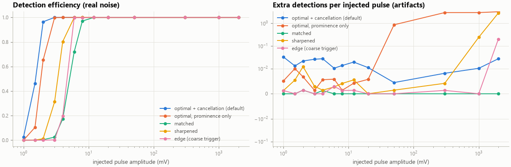
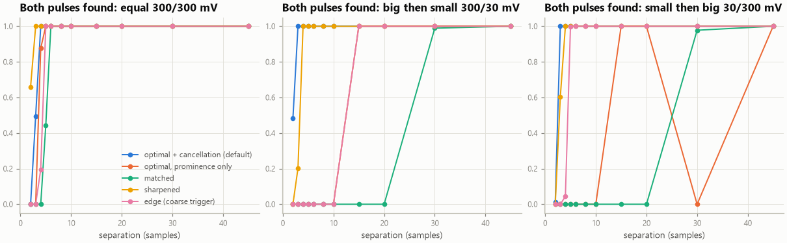
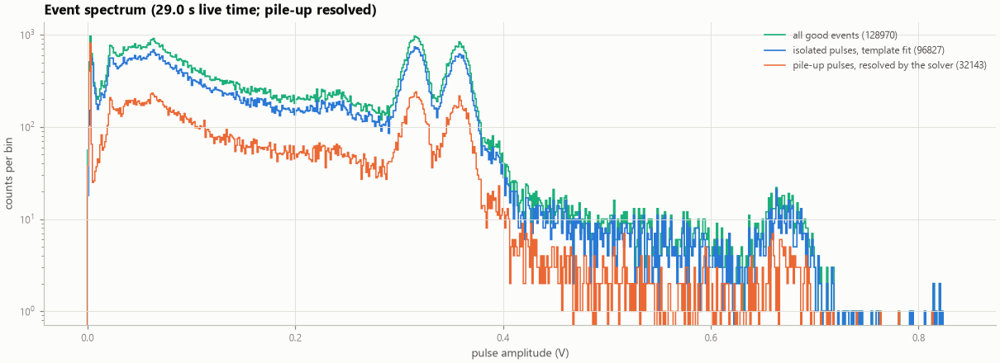

# Event detection and the event list

Detection turns the clean signal (after [pre-processing](baseline-restoration.md)) into a
list of pulses. This is the data-reduction step: ~7 MB of text per capture become a few
kB of events. Code: `gamma_spectrometry/detect.py`, `gamma_spectrometry/pipeline.py`, `gamma_spectrometry/events.py`.
Decision record: [ADR-0007](adr/0007-optimal-filter-successive-cancellation.md).

```text
clean signal ─► optimal filter ─► successive cancellation ─► pulses ─► clusters, flags, template fits ─► event file
                (per capture)      (two passes, local thresholds)
```

## Method

### 1. Optimal filter (per capture)
The amplitude of a pulse of known shape **s** in coloured noise with covariance **C** is
best estimated (smallest variance) by

$$\hat A[n] = \frac{h^T x_n}{h^T s},\qquad h = C^{-1}s$$

where $x_n$ is the signal window around sample n. This is the noise-whitened matched filter.
For white noise h = s (plain matched filter). C is a Toeplitz matrix built from the noise
autocovariance, measured for **each capture** from its pulse-free samples, so the filter
adapts when interference switches on or off. The system is solved with the Levinson
algorithm. The kernel covers 6 samples before to 60 after the peak of the
pole-zero-corrected template.

### 2. Successive cancellation (CLEAN)
The optimal filter's response to a pulse is narrow but has negative dips and small bumps
up to ~50 samples before its peak. A plain peak search reports those as extra pulses (3
per 1 V pulse). Instead:

1. take the largest remaining local maximum of the filter output;
2. accept it if it exceeds the threshold plus a margin of 3 % of any accepted pulse whose
   response overlaps (real pulses don't match the template perfectly), it is a local
   maximum, and it is at least 3 samples from an accepted pulse;
3. find its sub-sample position (parabola), and subtract its **exact** predicted response
   (from a table of 16 sub-sample phases);
4. repeat, then search the **residual** again (up to 4 passes): pulses hidden under a
   larger pulse's negative dips appear there.

### 3. Thresholds
5.5 × the noise sigma of the filter output, measured in blocks of 4096 samples (the
interference comes in bursts), from the negative half of the output (pulses are positive).
The first pass's estimate is inflated by real pulses' dips, so the noise is re-measured on
the residual after cancellation and the detection repeated with that threshold.

### 4. Events
For each capture (`Pipeline.process_capture`):

* **clusters:** pulses closer than 60 samples share a cluster (their fit windows overlap);
* **flags:** `PILEUP`, `WARMUP` (first 1500 samples), `EDGE`, `BAD_FIT`, `LARGE` (> 1.5 V),
  `AFTER_LARGE`;
* **isolated pulses** are fitted with the template (baseline fixed at 0 after restoration):
  amplitude, sub-sample time, fit rms;
* **pile-up clusters** keep their detection amplitudes and a waveform snippet for the
  pile-up solver (steps 5–6);
* everything is appended to the [event file](data-formats.md#event-file-h5), and the full
  configuration is stored in it.

Captures are independent, so `run` processes them in parallel worker processes.

## Evaluation with injected pulses

`gamma-spectrometry evaluate-detection`: template pulses injected into the real clean noise of
20 captures (⁶⁰Co run, 2.1 s of noise), and into the same noise with randomised Fourier
phases (same spectrum, no pulses) for the false-trigger rate.

| Method | Output noise σ | False triggers (pure noise) | Efficiency 2 / 3 / 4 / 6 mV | Extra detections per 1 V pulse |
|---|---|---|---|---|
| **optimal + cancellation (default)** | **0.25 mV** | **0 /s** | **0.96 / 1.00 / 1.00 / 1.00** | **0.010** |
| optimal, peak search only | 0.25 mV | 0 /s | 0.65 / 1.00 / 1.00 / 1.00 | 3.0 |
| matched filter | 0.96 mV | 0 /s | 0.00 / 0.03 / 0.17 / 0.72 | 0.000 |
| sharpened | 0.55 mV | 0 /s | 0.01 / 0.31 / 0.80 / 1.00 | 0.24 |
| leading edge | 0.49 mV | 0 /s | 0.00 / 0.00 / 0.20 / 1.00 | 0.000 |



**Pile-up pairs**: fraction where both pulses are found as two separate events:

| Separation (samples) | 2 | 3 | 4 | 6 | 10 | 15 | 30 |
|---|---|---|---|---|---|---|---|
| optimal + cancellation, 300/300 mV | 0.00 | 0.49 | 1.00 | 1.00 | 1.00 | 1.00 | 1.00 |
| optimal + cancellation, 300 then 30 mV | 0.48 | 1.00 | 1.00 | 1.00 | 1.00 | 1.00 | 1.00 |
| optimal + cancellation, 30 then 300 mV | 0.01 | 1.00 | 1.00 | 1.00 | 1.00 | 1.00 | 1.00 |
| matched filter, 300/300 mV | 0.00 | 0.00 | 0.00 | 1.00 | 1.00 | 1.00 | 1.00 |
| matched filter, 300 then 30 mV | 0.00 | 0.00 | 0.00 | 0.00 | 0.00 | 0.00 | 0.99 |



(The ±2-sample exclusion makes pairs closer than 3 samples one event by design.)

## Results on the 2021 data (first 100 captures each)

| | ⁶⁰Co run | Background run |
|---|---|---|
| Events | 132,398 | 35,074 |
| Rate | 4,545 /s | 1,204 /s |
| Filter noise / threshold (median) | 0.28 / 1.53 mV (≈ 6 keV) | 2.22 / 12.2 mV |
| Clean (isolated, fitted) | 96,828 | 29,818 |
| Flagged pile-up | 26.0 % | 14.1 % |
| Bad fit / large / after large | 0.5 / 0.2 / 0.1 % | 0.4 / 0.5 / 0.3 % |
| Event file (with pile-up snippets) | 10.5 MB (70× smaller than the ASCII input) | 1.95 MB (377×) |
| Processing speed | 1.6× real time (parallel) | 1.5× real time |

* **Statistics check (⁶⁰Co):** for pulse pairs where both exceed 5 mV, the count at each
  separation of ≥ 4 samples (269–356 per sample) matches random arrivals (≈ 308);
  separation 3 is ≈ 1.7× high (some mismatch residuals remain there).
* **Background run, noisy captures:** heavy-tailed interference bursts give ≈ 300 /s extra
  events between 10 and 30 mV and an excess of close pairs. Above 30 mV, quiet and noisy
  captures have identical rates (630 vs 631 /s). Use an energy threshold above ~30 mV
  (≈ 120 keV) or select captures by `captures.sigma_in_v` for low-energy work.
* **Size:** events take ~19 bytes each; most of the file is pile-up snippets. The full
  3-hour ⁶⁰Co run is expected to give ≈ 0.5 GB (≈ 0.12 GB without snippets), against
  33 GB of text.



## Known limitations (next steps)

* Pile-up clusters (26 % of ⁶⁰Co events) have only detection-filter amplitudes. Resolving
  their energies is steps 5–6 (benchmark, then solver); their waveforms are stored as
  snippets for that.
* Pairs closer than 3 samples are one event; a hidden second pulse shows up as a poor fit.
