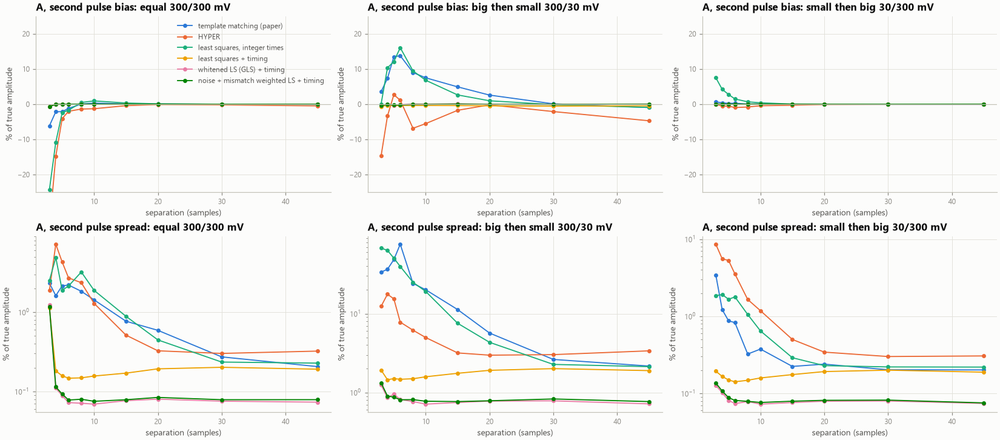
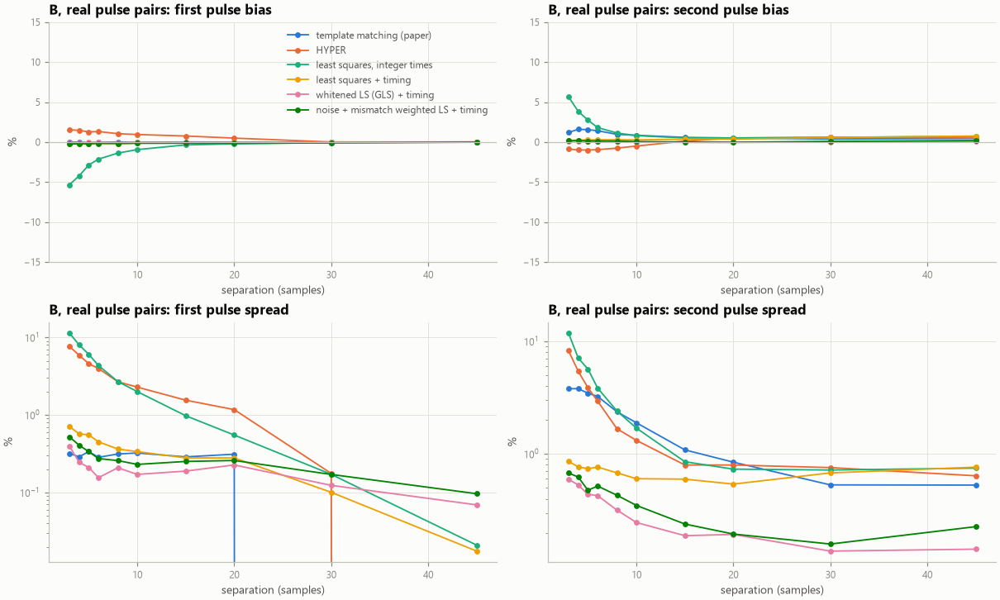
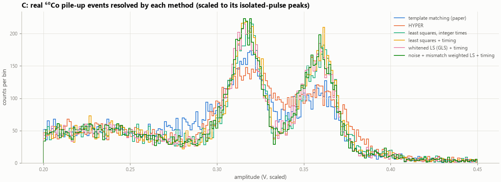

# Pile-up benchmark (step 5)

About a quarter of the ⁶⁰Co events overlap another pulse within 60 samples (33 µs). Their
energies need a method that separates the overlapping pulses. This benchmark compares the
methods from Mohammadian-Behbahani & Saramad (2020), *A comparison study of the pile-up
correction algorithms* (NIM A 951, 163013), on our data, plus refinements suggested by
the results. Decision: [ADR-0008](adr/0008-pileup-weighted-least-squares.md).

Code: `gamma_spectrometry/pileup.py` (methods), `gamma_spectrometry/pileup_eval.py` (benchmark).
Run: `gamma-spectrometry evaluate-pileup STORE TEMPLATE EVENTS OUT_DIR`.

## Methods

All methods get the clean waveform of a cluster (after [pre-processing](baseline-restoration.md),
baseline 0) and the pulse positions from the [detector](detection.md).

| Method | Idea | Notes |
|---|---|---|
| **TM**, template matching (paper; Vencelj et al.) | sample heights b at each peak; b = M a with M_pq = s(t_p − t_q), lower triangular | uses one sample per pulse |
| **HYPER** (Wong & Li) | D = y + λ∫y is constant between pulses for mono-exponential pulses; A_p = D_p − D_{p−1} e^{−λΔt} | assumes a single exponential |
| **LS**, least squares (the paper's MLE for white noise) | y = Σ A_k s(t − t_k) over the whole cluster | positions as integer samples |
| **LS + timing** | LS with each t_k refined below one sample (Gauss–Newton with the template derivative) | |
| **GLS + timing** | LS weighted by the inverse noise covariance (prewhitening) | maximum likelihood for an exact template |
| **WLS + timing** | weights from noise **plus** template mismatch: C = C_noise + (εA)² I, ε = 0.35 % | GLS for small pulses, LS for large |

SER (single event reconstruction) was not implemented. The paper shows it degrades most at
low sampling rates and needs many samples per pulse, and our pulses are only ~25 samples
long at 1.8 MS/s.

ε comes from the template fits of 96,000 isolated pulses: their residual rms follows
rms² = σ₀² + (εA)² with σ₀ = 0.67 mV (noise) and **ε = 0.35 %** (shape mismatch), so
above ~0.2 V the mismatch dominates.

## Three tests

Every estimate is compared with **the same method's estimate of the same pulse alone**, so
each method's own scale cancels and only the pile-up error remains.

* **A: template pairs in real noise.** Two template pulses, random sub-sample phases,
  separation 3–45 samples, amplitude pairs 300/300, 300/30 and 30/300 mV, injected into
  the real clean noise, **found by the real detector**, clustered as in the pipeline.
* **B: real-pulse pairs.** Two real isolated pulses (with their real shape variations and
  noise) added at separations of 3–45 samples, resolved with their known positions.
* **C: the real pile-up events.** The 33,551 ⁶⁰Co pulses in clusters of 2–4 (first 100
  captures). For every method, the resolved ⁶⁰Co peaks are compared with that method's
  peaks for 26,804 isolated pulses: same position (no shift) and same width.

## Results

### A: template pairs in real noise (second pulse: bias / spread, %)

| Method | 300/300 mV at 4 / 6 / 10 samples | 300 then **30** mV at 4 / 6 / 10 / 30 | 30 then 300 mV at 3 / 6 |
|---|---|---|---|
| TM (paper) | −2.1/1.6, −1.2/2.2, +0.3/1.4 | +7.3/37, +14/76, +7.5/20, +0.1/2.6 | +0.6/3.4, +0.3/0.8 |
| HYPER | −15/7.2, −2.0/2.7, −1.3/1.3 | −3.4/18, +1.1/7.8, −5.5/5.0, −2.1/3.0 | 0.0/8.6, −1.0/3.5 |
| LS, integer times | −11/4.9, −1.7/2.1, +0.9/1.9 | +10/63, +16/40, +6.8/19, −0.1/2.3 | +7.5/1.8, +1.5/1.8 |
| LS + timing | −0.1/0.2, 0.0/0.1, 0.0/0.2 | −0.3/1.5, −0.3/1.5, −0.4/1.6, −0.5/2.0 | 0.0/0.2, 0.0/0.1 |
| GLS + timing | 0.0/0.1, 0.0/0.1, 0.0/0.1 | −0.1/0.9, −0.1/0.8, 0.0/0.7, −0.1/0.8 | 0.0/0.1, 0.0/0.1 |
| **WLS + timing** | **0.0/0.1, 0.0/0.1, 0.0/0.1** | **−0.1/0.9, −0.2/0.8, −0.1/0.8, −0.1/0.8** | **0.0/0.1, 0.0/0.1** |

The detector finds equal 300/300 mV pairs as two pulses in 20 / 76 / 93 / 100 % of cases
at 3 / 4 / 5 / 6 samples, and unequal pairs in 100 % from 3 samples.

At 1.8 MS/s a pulse rises in about one sample, so where the peak falls between samples
matters. TM and integer-time LS read the waveform at sample positions and are wrong by up to
+16 % (mean) and 76 % (spread) for a small pulse 4–10 samples after a large one. Fitting the
sub-sample time removes this almost entirely. HYPER's single-exponential model leaves
biases of several percent.

### B: real-pulse pairs (first | second pulse: bias / spread, %)

| Method | 3 samples | 6 samples | 10 samples | 30 samples |
|---|---|---|---|---|
| TM (paper) | 0.0/0.3 \| +1.2/3.8 | 0.0/0.3 \| +1.4/3.2 | 0.0/0.3 \| +0.8/1.9 | 0.0/0.0 \| +0.4/0.5 |
| HYPER | +1.5/7.7 \| −0.9/8.3 | +1.3/4.0 \| −1.0/2.9 | +0.9/2.3 \| −0.5/1.3 | 0.0/0.2 \| +0.6/0.8 |
| LS, integer times | −5.3/11 \| +5.7/12 | −2.1/4.4 \| +1.8/3.8 | −0.9/2.0 \| +0.8/1.7 | −0.1/0.2 \| +0.6/0.7 |
| LS + timing | −0.2/0.7 \| +0.2/0.9 | −0.1/0.5 \| +0.3/0.8 | −0.1/0.3 \| +0.3/0.6 | 0.0/0.1 \| +0.6/0.7 |
| GLS + timing | −0.1/0.4 \| +0.1/0.6 | 0.0/0.2 \| +0.1/0.4 | 0.0/0.2 \| 0.0/0.2 | 0.0/0.1 \| 0.0/0.1 |
| **WLS + timing** | **−0.2/0.5 \| +0.2/0.7** | **−0.2/0.3 \| +0.1/0.5** | **−0.2/0.2 \| 0.0/0.3** | **−0.1/0.2 \| +0.1/0.2** |

### C: the real ⁶⁰Co pile-up events

FWHM of the 1173 / 1332 keV peaks (%), and the shift of the pile-up peaks relative to the
same method's isolated-pulse peaks:

| Method | Isolated pulses (26,804) | All pile-up (33,551) | Pile-up shift | Gap < 10 samples (6,922) | Gap 10–30 (11,047) |
|---|---|---|---|---|---|
| TM (paper) | 8.91 / 6.07 | 8.97 / 6.62 | +0.53 / +0.30 | 9.81 / 6.93 | 8.65 / 6.80 |
| HYPER | 10.53 / 11.28 | 10.72 / 9.58 | +0.96 / +0.37 | 8.80 / 11.73 | 11.57 / 8.60 |
| LS, integer times | 6.26 / 5.90 | 6.50 / 6.20 | +0.47 / +0.46 | 7.85 / 10.00 | 6.46 / 6.20 |
| LS + timing | **6.23 / 5.83** | **6.22 / 5.96** | +0.46 / +0.47 | 6.79 / 5.77 | 5.96 / 6.19 |
| GLS + timing | 6.49 / 5.95 | 6.63 / 6.00 | **+0.13 / +0.19** | 7.44 / 5.56 | 6.49 / 6.39 |
| **WLS + timing** | 6.30 / 5.88 | 6.46 / 5.96 | **+0.15 / +0.22** | 7.00 / 5.95 | 6.28 / 6.31 |

Statistical uncertainty of each FWHM: about ±0.1 (isolated, all pile-up) to ±0.25 (subsets).

* **TM and HYPER broaden even isolated pulses** (8.9 % and 10.5 % instead of 6.2 %): one
  sample per pulse (TM) or a single-exponential model (HYPER) is not enough when the
  pulse rises within one sample.
* **With timing refinement, pile-up events are measured as well as isolated ones**: the
  resolved peaks have isolated-like widths (6.2–6.5 % / 5.9–6.0 %), down to separations
  under 10 samples.
* **GLS vs LS on real pulses.** GLS is best in tests A and B but gives slightly wider
  isolated ⁶⁰Co peaks than LS (6.49 vs 6.23 %). This is the paper's warning that MLE is
  sensitive to template mismatch: whitening puts most weight on the sharp rising edge,
  where real pulses differ most from the template, and at ⁶⁰Co energies the mismatch
  (0.35 % × A ≈ 1 mV) is larger than the noise (0.67 mV). WLS includes the mismatch in the
  weights and gets the best of both: GLS-level accuracy for small and close pulses, LS-like
  resolution for large ones, and the smallest pile-up shift.
* The remaining shift of pile-up peaks (+0.15 to +0.22 % for WLS) is well below the peak
  width; the calibration step will check it with the full data.

### Speed (one core, two-pulse cluster)

TM 0.16 ms, HYPER 0.04 ms, LS 0.10 ms, LS + timing 1.3 ms, GLS + timing 2.3 ms,
WLS + timing 2.4 ms. At ~530 pile-up clusters per second, WLS needs ~1.3 cores; the
pipeline already runs captures in parallel, and the solver (step 6) can be made faster
(fewer iterations, normal equations, compiled loops).

## Conclusion

**Use weighted least squares with sub-sample timing (WLS + timing)** as the pile-up solver
(step 6). The paper's TM, which worked well before, is the right idea (a linear model of
superposed templates), but at this sampling rate it must use all samples and fit the
sub-sample arrival times. Weighting by noise and template mismatch makes it robust for
both small and large pulses.
