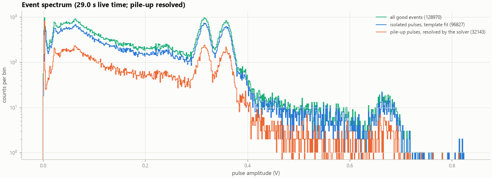

# Pile-up solver (step 6)

The pile-up solver gives every pulse in a pile-up cluster its own energy, and finds pulses
the detector merged. It implements the method chosen in the
[benchmark](pileup-benchmark.md) ([ADR-0008](adr/0008-pileup-weighted-least-squares.md)).
Code: `gammaspec/solver.py`, called from `Pipeline._solve_clusters` (`gammaspec/pipeline.py`).

```text
detected events ─► clusters ─► isolated: template fit (fast)
                              └► pile-up clusters and badly fitted isolated pulses:
                                   WLS + timing fit ─► residual search ─► refit ─► amplitudes, times, new pulses
```

## Method

For each cluster, a window from 10 samples before its first pulse to 40 after its last:

1. **Fit:** y(t) = Σ A_k s(t − t_k), weighted by C = C_noise + (ε A_max)² I.
   * C_noise is the noise autocovariance of this capture (512 lags, from its pulse-free
     samples, tapered so the Toeplitz matrix stays positive definite). ε = 0.35 % is the
     measured template mismatch.
   * The times are refined by Gauss–Newton with the template derivative, within ±1.25
     samples of the detected positions, until they move by less than 0.005 samples.
2. **Residual search** for pulses closer than 3 samples (which the detector merges) or
   missed. For every candidate time τ (half-sample steps), the whitened residual r_w and
   template s_w(τ) give the amplitude and significance of one more pulse:

   A* = s_w·r_w / s_w·s_w,  z = s_w·r_w / √(s_w·s_w)

   If the best z exceeds **8**, the pulse is added, everything is refitted, and the new
   pulse is kept only if it is still significant. Up to 2 pulses per cluster.
3. **Quality:** residual rms; `BAD_FIT` if rms > 4σ + 2 % × A_max.

The whitening matrix is formed once per cluster, so the iterations are only small matrix
products. Typical cost: ~1.1 ms per two-pulse cluster (one core).

Isolated pulses keep the fast template fit of step 4; the two agree to within 0.02 %
(below). The solver also runs on isolated pulses with a bad fit, which may hide a second
pulse.

### Tuning the residual-search threshold

On 3,000 real isolated pulses (where nothing should be added) and on template pairs closer
than 3 samples in real noise:

| Threshold z | False additions (real isolated pulses) | Recovered second pulse at 1 / 2 / 3 samples |
|---|---|---|
| 5 | 1.1 % | 0.76 / 1.00 / 1.00 |
| 6 | 0.40 % | 0.70 / 1.00 / 1.00 |
| 7 | 0.40 % | 0.73 / 1.00 / 1.00 |
| **8 (default)** | **0.27–0.30 %** | **0.74 / 1.00 / 1.00** |

Two pulses one sample (0.56 µs) apart are inherently hard to separate.

## Results (first 100 captures of each run)

`gammaspec report EVENTS.h5`:

| ⁶⁰Co run | Events | Centres (V) | Shift vs isolated | FWHM 1173 / 1332 keV |
|---|---|---|---|---|
| isolated (template fit) | 96,827 | 0.3157 / 0.3573 | — | 6.47 / 5.84 % |
| **pile-up, resolved by the solver** | **32,143** | 0.3156 / 0.3570 | −0.05 / −0.08 % | **6.45 / 5.94 %** |
| pile-up, gap 3–10 samples | 5,641 | 0.3158 / 0.3572 | +0.04 / −0.02 % | 7.54 / 5.61 % |
| pile-up, gap 10–30 samples | 11,072 | 0.3159 / 0.3569 | +0.08 / −0.11 % | 6.22 / 6.33 % |
| pile-up, gap 30–60 samples | 14,907 | 0.3151 / 0.3569 | −0.18 / −0.09 % | 6.34 / 5.75 % |
| **all good events** | **128,970** | 0.3157 / 0.3572 | −0.01 / −0.02 % | **6.47 / 5.86 %** |

(The 523 pulses less than 3 samples from a neighbour, including those found by the
residual search, are too few for their own peak fit; they are included in the totals.)

* **Throughput: 73.0 % → 97.3 %** of the valid events now have a usable energy, with **no
  loss of resolution and no peak shift** in the combined spectrum.
* **Background run:** throughput 84.7 % → 93.6 %; ⁴⁰K FWHM 6.74 % (isolated) vs 6.71 %
  (all good events), shift −0.02 %.
* The residual search added **595** pulses (0.4 % of events), mostly 1–2 samples from
  another pulse: pairs the detector had merged.
* `BAD_FIT` rose to 2.4 % of events, but almost entirely below 5 mV (≈ 20 keV): groups of
  tiny detections on slow ±6 mV noise waves that the 0.56 ms baseline tracker does not
  follow. Above 30 mV, bad fits are 0.2–0.5 %. Use an energy threshold of a few tens of
  keV for spectra.



## Speed

With the solver the pipeline runs at **1.1× real time** (⁶⁰Co, 4,570 events/s) and 1.4×
(background) on 7 worker processes. Each worker is limited to one BLAS thread: with
multi-threaded linear algebra in every worker, the processes oversubscribed the CPU, and
the pipeline ran at only 0.4× real time.

## Switching it off

`gammaspec process ... --no-pileup-solver` (or `--no-residual-search` to keep the fit but
not the search); `SolverConfig(enabled=False)` in code. The solver needs a restored
baseline and is disabled automatically (with a warning) if pole-zero correction or the
baseline tracker is off.
