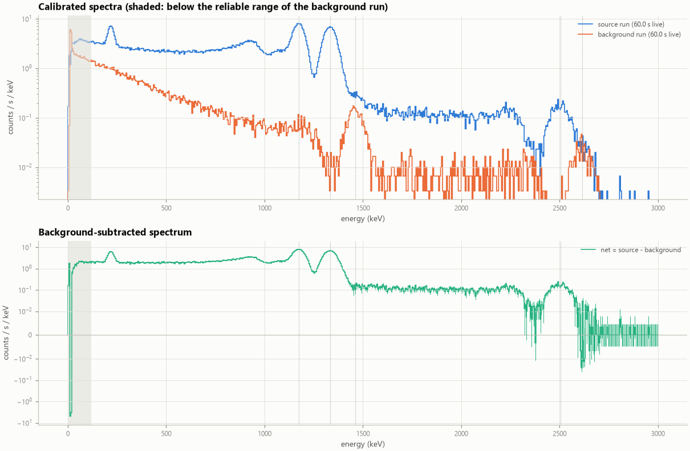

# Signal simulator (step 10)

`gammaspec.simulate` produces a realistic NaI(Tl) preamplifier waveform with known content, so the
pipeline can be tested beyond the recorded data. You can vary the source, rates, resolution,
noise and pulse shape, and score the result against the **truth**: every pulse the simulator
made.

Code: `gammaspec/simulate.py`. Decision record: [ADR-0012](adr/0012-streaming-overlapping-frames.md).

```bash
gammaspec run examples/run_simulation.toml            # source + background run, spectrum, truth check
gammaspec simulate data/sim/co60.h5 --captures 100    # a simulated capture store (+ co60.truth.h5)
gammaspec simulate data/sim/cs137.h5 --set nuclide=cs137 --set rate_cps=2000
gammaspec simulate - --realtime | gammaspec stream - out/live --template T.h5   # a live simulated signal
gammaspec stream sim out/sim --duration 20 --show     # simulate and process, with a live spectrum window
```

## The model

For each decay of the source (rate chosen so that the source gives `rate_cps` pulses/s) and
each room-background event (`background_cps`), the simulator goes through these steps:

| Step | Model | Settings (`[simulation.signal]`) |
|---|---|---|
| Emission | ⁶⁰Co: 1173.2 and 1332.5 keV **in the same decay**; ¹³⁷Cs: 661.7 keV (85 %); ⁴⁰K: 1460.8 keV. Background: ⁴⁰K 1461 keV (7 %), ²⁰⁸Tl 2615 keV (2 %), and a continuum falling as exp(−E / 250 keV). | `nuclide`, `background_*` |
| Interaction | Each gamma deposits energy with probability `efficiency`. Photopeak with P/T(E) = 0.45 · (E/662)^−0.6; backscatter E / (1 + 2E/mc²) for 4 %; otherwise one Compton scatter, electron energy from the Klein–Nishina distribution up to the Compton edge. | `efficiency`, `peak_to_total_*`, `backscatter_fraction` |
| Summing | Deposits of one decay add up into one pulse (the ⁶⁰Co 2506 keV sum peak). Chance coincidences come from the Poisson arrival times. | (`efficiency` sets the amount) |
| Resolution | Gaussian, FWHM/E = 8 % · √(662/E): 5.6 % at 1332 keV. | `fwhm_pct_662` |
| Pulse | amplitude = E / gain (3760 keV/V) times the pulse shape: the analytic model fitted to the 2021 template (rise 0.44, decay 7.5 samples, undershoot 76 and 318 samples, zero net area) or any template file; sub-sample arrival times. | `gain_kev_per_v`, `pulse_template` |
| Electronics | Gaussian noise 0.6 mV rms (white, or shaped like a measured noise spectrum), interference at 9, 18, 27 and 257 kHz, offset 4 mV, negative polarity, ADC step 84.8 µV. | `noise_v`, `noise_psd`, `lines_hz`, `lines_v`, `offset_v`, `polarity`, `lsb_v` |

The defaults resemble the 2021 run:
* ~3,900 source + 600 background pulses/s;
* the same pulse shape, ADC and polarity;
* a ⁶⁰Co sum peak of ~20 counts/s in its window.

`seed` makes a run reproducible. Events are generated in fixed blocks of 65,536 samples, so
the waveform is identical however it is read (`read(7)` then `read(19993)` equals
`read(20000)`). It is also continuous across reads: a pulse that straddles a read is
completed in the next one. The simulator itself runs at ~2.9× real time (5 MS/s).

Not modelled:
* multiple Compton scattering inside the crystal (it fills the region between the Compton
  edge and the peak) and X-rays;
* angular correlation of the ⁶⁰Co cascade;
* non-proportional light yield;
* gain drift.

The simulator is a test bench, not a detector response calculation.

## Truth and scoring

Every pulse is recorded: arrival time, true amplitude, energy, and whether it came from the
source or the background ([format](data-formats.md#simulation-truth-truthh5-truthrunh5)).
`compare_to_truth(events, truth)` matches detected events to true pulses by time
(±2 samples), counting only the truth inside each capture's or frame's live region. It reports:

* **efficiency** by true energy (found / true);
* **false detections** per second (detected events with no true pulse within ±2 samples);
* **amplitude bias and spread** of good events above 50 mV (median and 1.48·MAD of the
  relative error);
* **close pairs resolved**: of the true pairs 2–60 samples apart (both > 100 keV), the
  fraction found as two distinct events.

A simulated run (`input.kind = "simulation"`) writes these to `simulation_check.json`.

## Results: the pipeline against the truth

Default simulation, 16 captures (4.65 s live, ~4,500 pulses/s), default pipeline, batch
processing:

| Metric | Result |
|---|---|
| Efficiency, 30–100 keV | 96.2 % |
| Efficiency, 100–300 / 300–600 / 600–1000 keV | 99.3 / 99.4–99.6 / 99.7–99.9 % |
| Efficiency, 1000–1500 / 1500–3000 keV | 99.8–99.9 / 100 % |
| Close pairs (2–60 samples) found as two events | 99.4 % |
| False detections | 21–25 /s (0.5 % of the rate) |
| Amplitude bias (good events > 50 mV) | +0.5 to +0.6 % |
| Amplitude spread (same) | 0.3–0.4 % |

What this shows:
* **Pulses are found:** above 100 keV the pipeline misses < 1 %. The losses at 30–100 keV
  are pulses within ±2 samples of a much larger one, or hidden in its tail.
* **Pile-up is resolved:** 99.4 % of close pairs come out as two pulses.
* **False detections are in pile-up clusters:** all of them are inside clusters (an average
  of 5.8 pulses), at 10–35 mV, 3–47 samples from the nearest true pulse. They are leftovers
  of fitting dense pile-up, and are only measurable with the truth. Raising
  `detect.margin` from 0.03 to 0.06 halves them, but loses 6 % of the 30–100 keV pulses,
  so the default stays.
* **The amplitude scale is biased by +0.5 %:** a constant gain error, which the energy
  calibration absorbs. In absolute terms, the amplitude error is +0.6 mV at 50–200 mV and
  +1.5–1.9 mV at 200–1000 mV, i.e. close to proportional.
* **The amplitude noise is ~0.84–1.2 mV rms** for isolated pulses at all amplitudes:
  electronic noise, not template error.

### A full simulated measurement (`examples/run_simulation.toml`)

60 s of ⁶⁰Co source plus room background, and 60 s of background alone, streamed (0.81× and
1.13× real time), calibrated, background-subtracted and checked against the truth:

| | Source run | Background run |
|---|---|---|
| True pulses | 267,116 (4,452 /s) | 35,845 (597 /s) |
| Efficiency 30–100 / 100–300 / > 300 keV | 96.1 / 99.3 / ≥ 99.6 % | 99.8 / 99.9 / ≥ 99.9 % |
| Close pairs resolved | 99.6 % | 99.7 % |
| False detections | 14.8 /s | 43.2 /s (see below) |
| Amplitude bias / spread (> 50 mV) | +0.50 / 0.31 % | +0.17 / 0.30 % |
| Calibration | E = 7.9 + 3719.8 A keV, from 3 lines (residuals ≤ 2.2 keV) | own lines (⁴⁰K, ²⁰⁸Tl): gain ratio to the source run 1.007 |



The spectra show what the model contains: the backscatter peak (~210 keV), the Compton
edge (~960 keV), both photopeaks, the 2506 keV sum peak, ⁴⁰K and ²⁰⁸Tl in the background,
and ⁴⁰K gone from the net spectrum.

The simulated gain is 3760 keV/V. The calibration finds 3720 (+0.5 % amplitude bias, and the
offset absorbs the rest), and the background run is calibrated consistently with the source
run (0.7 %).

**Resolution: the processing adds no measurable broadening.** The good events, calibrated
and fitted exactly as in the benchmark, give FWHM 5.24 / 4.98 % (± 0.05) at 1173 / 1332 keV.
The true deposited energies, fitted the same way, give 5.25 / 4.98 %. With 0.6 mV of noise
on ~350 mV pulses, the electronics contribute < 0.2 % in quadrature, and the pipeline does
not add to it.

### Two findings that only a simulation can show

1. **Line removal creates small false pulses at low rates.**
   * **Symptom:** the background run (600 /s, quiet noise) has 43 false detections/s at
     2–4 mV (threshold 1.7 mV), far from any true pulse. Their positions repeat every
     512 samples, i.e. they are tied to the line-removal blocks.
   * **Cause:** the 9–27 kHz sinusoids fitted per 1,024-sample block absorb part of the pulse
     undershoots, which are masked out of the fit for only 60 samples but last ~1,500.
     Subtracting the fit leaves ripples.
   * **Evidence:** they vanish without interference in the signal (0.1 /s), with line
     removal off (0.5 /s), and with 4,096-sample blocks (0.0 /s).
   * **Why the default stays:** on the real data the block length makes no difference to
     the results (FWHM 6.53 / 6.04 vs 6.54 / 6.05 %, event rate −0.1 %), because the real
     background run's noise threshold (12 mV) hides the effect. The default (1,024, chosen
     in step 3 to follow drifting lines) is kept.
   * **For quiet, low-rate measurements:** set `pipeline.preprocess.lines.block = 4096`.
     The false pulses are below ~15 keV, under the 120 keV limit of the background
     subtraction.
2. **The peak fit underestimates the FWHM when the continuum is not linear.**
   * Fitted alone, the ⁶⁰Co photopeaks give the simulated resolution (5.93 / 5.60 % vs
     6.01 / 5.64 %).
   * With the Compton continua, the joint fit of two Gaussians on a linear background
     (1040–1440 keV) gives 8–10 % narrower peaks (5.46 / 5.06 %). The 1332 keV Compton edge
     (1118 keV) lies under the low side of the 1173 keV peak, and a straight line cannot
     follow it.
   * **For the real data:**
     * The comparisons between chains in [benchmark.md](benchmark.md) use one fit for all,
       so they are unaffected.
     * Absolute FWHM values (6.05 % at 1332 keV) may be underestimated by up to this amount.
     * The size of the bias depends on how sharp the Compton edge is, and the simulation
       (single scattering) makes it sharper than a real crystal does.
   * A continuum model with a Compton-edge shape would remove the bias.

These numbers apply to the simulated detector. They test the processing, not the 2021
detector: its real pile-up, shape variations and interference differ in the details.

## Limitations

* The simulator's pulse shape is the pipeline's template (unless `pulse_template` and
  `template.path` differ). Shape mismatch, a real effect, is therefore absent by default.
  Simulating with the measured template file while the pipeline uses the analytic model
  (or the other way round) tests it.
* Background run and source run share the detector model; a gain change between them (as in
  2021) can be simulated with a different `gain_kev_per_v`.
