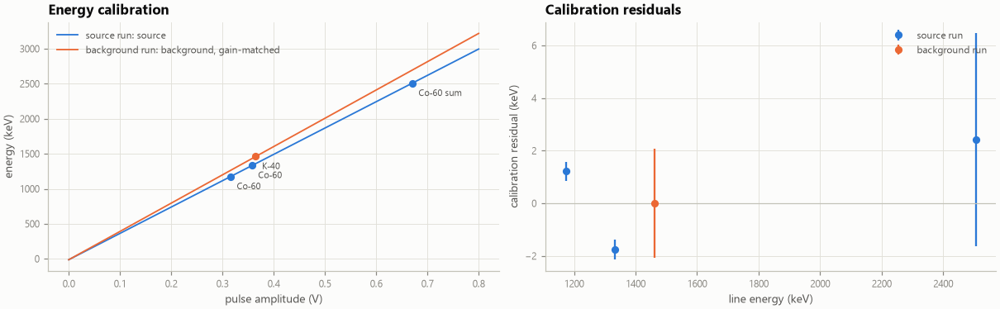
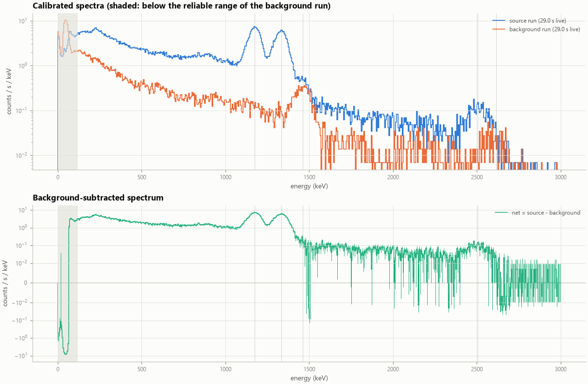
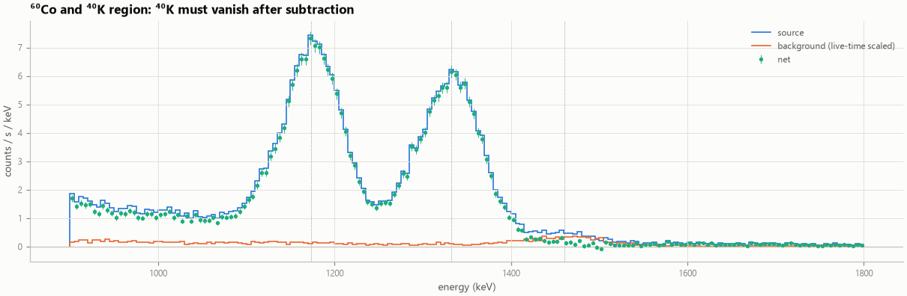

# Energy calibration, gain matching and background subtraction (step 7)

The last processing step turns event amplitudes (volts) into calibrated energy spectra
and subtracts the room background.
Code: `gammaspec/calibration.py`, `gammaspec/analysis.py`.
Decision record: [ADR-0009](adr/0009-calibration-per-run.md).

```bash
gammaspec spectrum data/events/source_first100.h5 data/spectrum/first100 --background data/events/background.h5
```

Outputs: `calibration_source.json`, `calibration_background.json`, `spectrum.csv` (bins,
counts, rates, net rate and its error), `spectrum_summary.json`, and the plots
`calibration.png`, `spectrum.png`, `spectrum_zoom.png`.

## Method

### 1. Calibration of each run
* **Anchor:** a first gain estimate from an unmistakable line. In the source run, the
  ⁶⁰Co pair: two strong peaks whose centres are in the ratio 1332.5 / 1173.2 = 1.1357. In the
  background run, the strongest peak, ⁴⁰K (1460.8 keV).
* **Line search:** each library line is predicted at E / gain. Lines within 16 % of each
  other are fitted together (Gaussians on a linear background, `spectrum.fit_peaks`), with
  bounds: centre within ±4 % of the prediction, width within 0.5–2× the expected NaI(Tl)
  resolution (FWHM 6.5 % at 1173 keV, scaling as 1/√E), area ≥ 0. A line is **accepted** if
  it is ≥ 4σ significant, its centre is not at a bound and its width is not pinned at a
  bound. If a line is rejected, it is dropped and the rest of its group refitted: a weak
  line next to a strong one otherwise makes the joint fit degenerate.
* **Curve:** E = c₀ + c₁A (+ c₂A² with ≥ 4 lines if it clearly improves χ²), weighted least
  squares through the accepted lines.
* **Too few lines** (a short run): **gain matching**. The calibration shape of a reference
  run (same detector and electronics) is taken, with one free gain factor k:
  E(A) = E_ref(k·A), with k fixed by the run's own line(s).

Libraries: source run ⁶⁰Co 1173.2 / 1332.5 keV, ⁶⁰Co sum 2505.7 keV, ⁴⁰K 1460.8 keV,
²⁰⁸Tl 2614.5 keV; background run ²¹⁴Pb 351.9, ²⁰⁸Tl 583.2, ²¹⁴Bi 609.3, ²²⁸Ac 911.2,
⁴⁰K 1460.8, ²¹⁴Bi 1764.5, ²⁰⁸Tl 2614.5 keV.

### 2. Spectra and subtraction
Each run's good events (isolated and resolved pile-up, `EventFile.good()`) are converted
to keV with **that run's** calibration and histogrammed on the same bins (5 keV). Each
spectrum is divided by its own live time. Then

net rate = source rate − background rate,  σ² = N_s/t_s² + N_b/t_b²

per bin. Line rates (counts/s) are Gaussian fits in local windows with a linear continuum:
the ⁶⁰Co pair over 1040–1440 keV, and ⁴⁰K over 1300–1650 keV with the 1332 keV peak as a
(non-negative) nuisance peak, since ⁴⁰K sits on its flank.

### 3. Gain stability
`gain_vs_time` refits the anchor line(s) in chunks of 20 captures and reports the
relative gain of each chunk.

## Results (first 100 captures of each run, 29.0 s live time each)



| | Source run (⁶⁰Co, 26 Aug) | Background run (31 Aug) |
|---|---|---|
| Calibration | E = −12.6 keV + 3760.5 keV/V · A (linear) | gain-matched: E = −12.6 keV + 4039.4 keV/V · A |
| Lines used | ⁶⁰Co 1173, 1332, sum 2506 keV | ⁴⁰K 1461 keV (others < 4σ in 29 s) |
| Residuals | +1.2, −1.8, +2.4 keV | 0 (one line) |
| Gain drift between 20-capture chunks | ≤ 0.12 % (± 0.05 %) | ≤ 0.4 % (± 0.3 %, consistent with none) |

* **The background run gives 6.9 % less signal per keV** five days later (4039 vs 3760 keV per volt).
  Subtracting in raw volts would put the background's ⁴⁰K line 102 keV too low; calibrating
  each run on its own puts both on the same energy axis.
* The source calibration is linear within ±2.4 keV over 1.2–2.5 MeV (NaI(Tl) is close to
  proportional above a few hundred keV). ⁴⁰K, not used in it (its fitted width was pinned at
  a bound, so it was rejected), is predicted at 0.3918 V and measured at 0.3924 V.



| Line | Source run (counts/s) | Background run (counts/s) | **Net (counts/s)** |
|---|---|---|---|
| ⁶⁰Co 1173.2 keV | 513.4 ± 6.2 | −8.4 ± 5.7 | **521.8 ± 6.5** |
| ⁶⁰Co 1332.5 keV | 464.9 ± 6.6 | −22 ± 12 | **490.1 ± 7.4** |
| ⁴⁰K 1460.8 keV | 29.1 ± 4.8 | 39.4 ± 6.2 | **7.2 ± 3.1** |

Total rate above 120 keV: source 3945 /s, background 597 /s, net 3349 /s.



* **⁶⁰Co** remains after subtraction, and the background run has none (its ⁶⁰Co rates are
  consistent with zero).
* **⁴⁰K check:** the room-background line should vanish. The net ⁴⁰K is 7.2 ± 3.1 counts/s
  of a ~29 counts/s line, i.e. about 75 % removed and consistent with zero at 2.3σ. The
  source-run ⁴⁰K rate depends on how the flank of the 1332 keV peak is modelled (13–33
  counts/s for different windows and continuum shapes; the best-fitting window gives
  28–33 counts/s), while the background run's is robust (28–30 counts/s; equal in quiet and
  noisy captures). With these statistics the check is passed within its uncertainty, not
  more. The background run (only 29 s exists) limits it, and more source data will not
  improve it.
* **Below ~120 keV** (shaded) the background run is not reliable: in its noisy captures,
  interference bursts produce false events between 10 and 30 mV (≈ 40–120 keV, see
  [detection.md](detection.md)), and its detection threshold is 12 mV (≈ 50 keV). The net
  spectrum there is meaningless.
* Above 1.5 MeV the source run has a higher continuum than the background, from ⁶⁰Co
  summing (true coincidences of the cascade gammas, and chance coincidences at 4,500 /s).
  This is real and not removed by background subtraction.

## Limitations and next steps
* With 29 s of background, the net spectrum's uncertainty is dominated by the background
  run, especially at high energy. A longer background measurement would help most.
* Peak shapes are Gaussian; NaI(Tl) peaks have small low-energy tails. A tailed shape would
  make overlapping-line fits (⁴⁰K next to 1332 keV) less model-dependent.
* The full 3-hour source run (1,394 s live) can now be processed; gain drift over the 3 hours
  will be checked with `gain_vs_time`.
