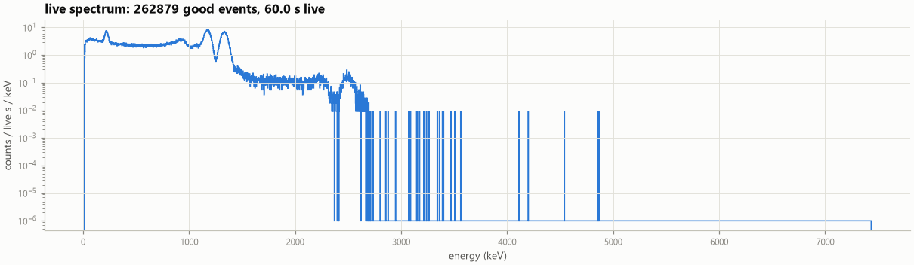

# Streaming: live and continuous input (step 10)

The pipeline was built on separate 0.29 s captures. Streaming lets it process a
**continuous** signal as it arrives, from any of these sources:
* a digitiser writing samples to a pipe;
* a replay of recorded data at real time;
* the [simulator](simulation.md).

It shows a live spectrum while it runs.

Code: `gammaspec/sources.py`, `gammaspec/stream.py`, `gammaspec/liveplot.py`.
Decision record: [ADR-0012](adr/0012-streaming-overlapping-frames.md).

```bash
gammaspec stream sim out/sim --duration 30 --show                       # simulated signal, live window
gammaspec simulate - --realtime | gammaspec stream - out/pipe --template T.h5   # samples on stdin
gammaspec stream data/source_first100.h5 out/replay --template T.h5 --realtime  # recorded data as a live stream
gammaspec run examples/run_replay_realtime.toml                          # the same from a run file
```

## Sources

| Source | `input.kind` | Delivers |
|---|---|---|
| `StoreSource` | `replay` (an `.h5` store) | each capture as a segment, in chunks |
| `RawSource` | `replay` (a raw folder) | each ASCII capture file as a segment; no conversion step |
| `SimulationSource` | `simulation` | one continuous segment ([simulation.md](simulation.md)) |
| `PipeSource` | `pipe` | binary samples from stdin (`-`), a file or a FIFO: `f4` / `f8` volts, or `i2` / `i4` ADC codes × `pipe_scale` |
| `Paced(source)` | `stream.realtime = true` | the chunks of a source, released at `speed` × real time: a live stream |

A *segment* is one continuous recording. A new segment (a new capture) means a gap in time
before it.

## Overlapping frames

Each segment is cut into frames:

```text
segment:  |<-pre->|<---------- core k ---------->|<-post->|
                                       |<-pre->|<---------- core k+1 ---------->|<-post->|
```

* The **core** (`stream.frame`, default 262,144 samples = 0.146 s) is where events are kept.
* **`pre`** (4,096) is context before the core. It must exceed the pre-processing warm-up
  (1,500 samples): the pole-zero filter restarts at the frame start, and an earlier pulse's
  undershoot is not corrected during the warm-up.
* **`post`** (2,048) is context after the core. It must cover the fit window (40), the
  baseline tracker's half-window (500) and a cluster gap (60).

The unchanged capture pipeline (`Pipeline.process_capture`) processes the whole frame. Events
whose peak is in the core are kept, so every kept event sees the same signal around it as an
event in the middle of a long capture. A segment's first frame has no `pre`: its warm-up is
flagged and is not live time, as at the start of a capture. Its last frame has no `post`, as
at the end of a capture. With `frame` ≥ the capture length, each capture is one frame, and
the result is **identical** to batch processing (tested).

Frames are independent:
* **Parallel:** they are processed in parallel worker processes and written in order.
* **No other state:** the only state between chunks is the buffered context, so the results
  do not depend on the chunk sizes a source delivers (tested).
* **Cheap transfer:** samples go to the workers as exact int32 ADC codes when they lie on
  the ADC grid (stores, raw files, the simulator), otherwise as float32.

**Live sources** (stdin, FIFO, `realtime`) cannot wait. When more than `max_backlog` (16)
frames are queued, the next frame is dropped and counted as **dead time**: its samples are
not live time. Rates and spectra per live second stay correct; only statistics are lost. The
status line shows the number of dropped frames.

## Live spectrum

While streaming, every `stream.update_s` (2 s):
* a status line: signal time, speed × real time, frames, dropped frames, backlog, events,
  rate, calibration;
* `live/<run>/live_spectrum.json`: counts per channel (4,096 channels over 0–2 V), live time
  and, once calibrated, the keV axis. A picture every `png_s` (30 s) and at the end.

The live spectrum calibrates itself once it has 20,000 good events (≈ 5 s at 4,500 /s), and
again at every doubling of the counts. It uses the same automatic calibration as
[spectrum.md](spectrum.md). `gammaspec stream --show` opens a window that redraws it. A UI
(step 11) can read the JSON file or pass an `on_update` callback to `runner.run`.



*The live spectrum at the end of the 60 s simulated source run (calibrated on the fly).*

After the stream ends, the usual steps follow: spectrum and background subtraction, the
benchmark (for a replayed store), and the truth check (for a simulation).

## Validation

**Streaming reproduces batch processing.** The 100 real captures, processed in 262,144-sample
frames (two per capture) vs one frame per capture (= batch):

| | Batch | Streamed frames |
|---|---|---|
| Events | 132,993 | 132,952 |
| Good events | 128,970 | 128,929 |
| Live time | 29.04 s | 29.04 s |
| FWHM 1173 / 1332 keV | 6.54 / 6.05 % | 6.56 / 6.04 % (± 0.07) |
| Valley-to-peak | 0.215 | 0.210 |
| Peak rates 1173 / 1332 / 1461 keV (/s) | 513.7 / 465.2 / 29.1 | 514.3 / 464.2 / 29.4 |

On simulated data, the same comparison against the truth:
* 99.5 % of events are found again within half a sample;
* the amplitude error of isolated pulses is 0.82–0.88 mV rms for frames, vs 1.14–1.23 mV
  for whole captures;
* the false-detection rate is similar (21 vs 25 /s).

The shorter frames are slightly *more* accurate: the pre-processing adapts its noise and
interference estimates to 0.15 s instead of 0.29 s.

**Live operation.** The 100 real captures replayed at real time
(`examples/run_replay_realtime.toml`) on this PC (6 threads, 5 workers):
* the source run dropped 26 of 200 frames (13 %), and its rate per live second is
  4,584 /s (batch: 4,579 /s);
* the live spectrum calibrated itself to E = −12.3 + 3759.6 A keV (batch: −12.9 + 3761.6).

## Speed

| Processing | Speed (× real time, 1.8 MS/s at ~4,500 pulses/s) |
|---|---|
| One process, per frame | 0.34–0.44× (solver ~50 %, detection ~30 %, pre-processing ~20 %) |
| Batch, 4 / 7 workers (6-thread PC) | 0.87 / 0.93× |
| Stream, 4 / 7 workers | 0.79 / 0.89× |
| Simulator alone | 2.9× |
| Simulation + stream, 5 workers, 60 s | 0.81× (source), 1.13× (background, 600 /s) |

Streaming is as fast as batch processing. On this PC it falls ~10 % short of real time for a
⁶⁰Co source at 4,500 pulses/s. A live input then loses ~10 % of its frames as dead time;
correctness does not change. The work per sample is fixed, so a machine with ~8 cores keeps
up, and so does a lower rate (the background run streams at 1.1× real time).

## Limitations

* Latency is one frame plus its post-context, plus processing: about 0.2–0.5 s.
* A pile-up cluster that crosses a core boundary is measured in both frames, and each frame
  keeps its own events, so its cluster id differs on the two sides. Pulses and amplitudes
  are not affected.
* The interference lines and the noise covariance are estimated per frame. Interference that
  changes within a frame is followed less closely than with shorter blocks.
